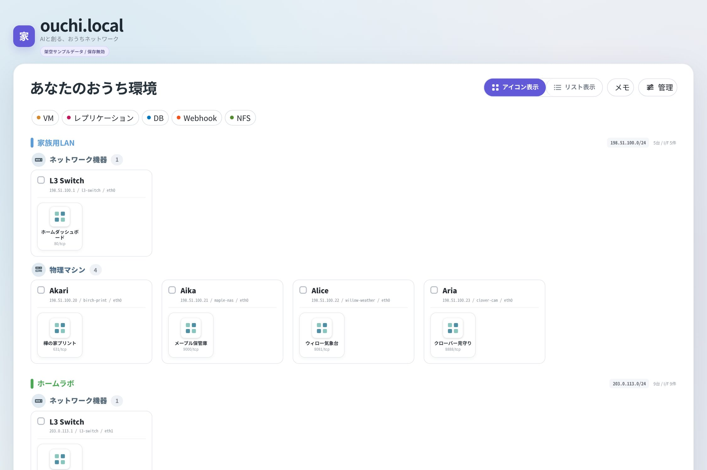
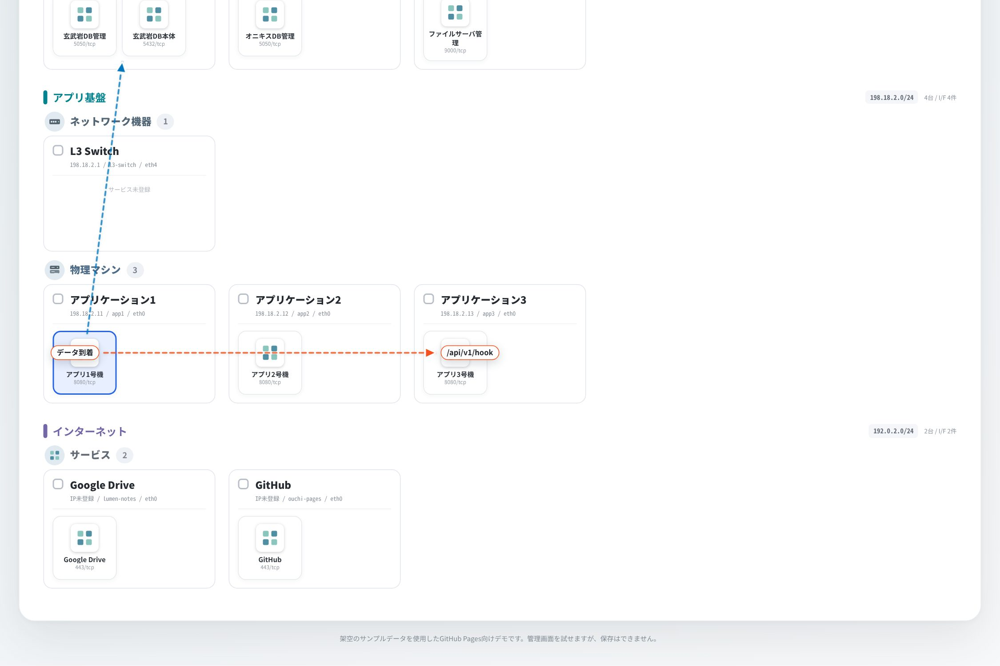
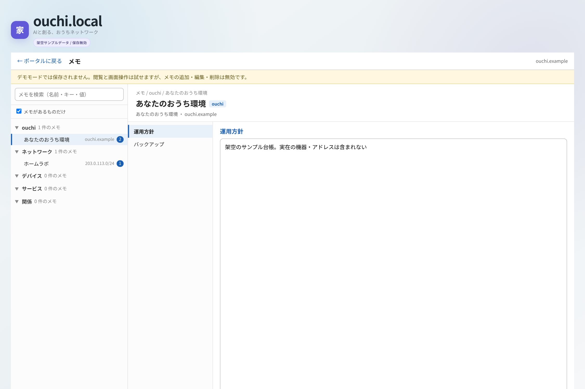
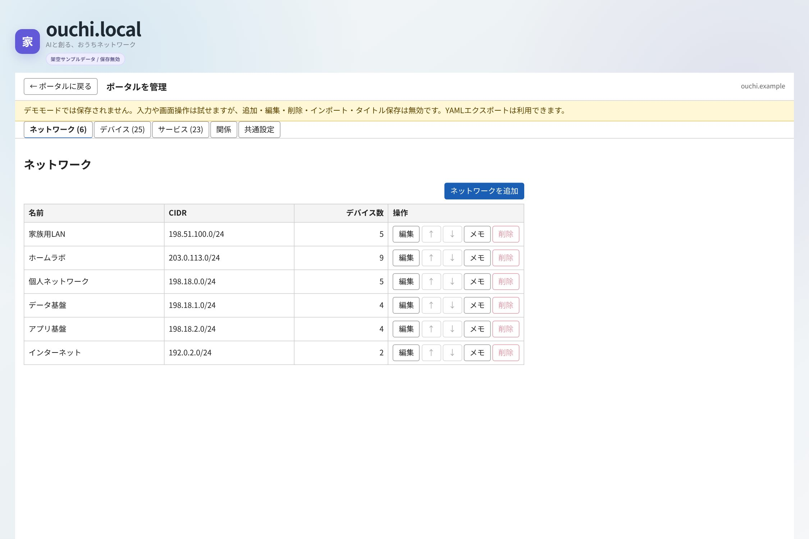

# ouchi.local

**おうちのネットワークを、1枚の地図に。**

自宅のサーバーやサービスが増えてくると、「あの管理画面、どこだっけ？」「このアプリ、どの DB を見てるんだっけ？」が分からなくなります。
ouchi.local は、家のネットワーク・機器・サービスと、その**つながり**を登録しておく台帳アプリです。
ポータルを開けば家全体が1画面に並び、タイルをクリックすれば各サービスの画面へそのまま飛べます。



> **触ってみたい方へ**: [オンラインデモ](https://moguno.github.io/ouchi/) がブラウザでそのまま動きます（架空のサンプルデータです。管理画面も試せますが、保存はされません）。

## できること

### 家全体を1画面に

ネットワークごとに、機器（カード）とサービス（タイル）が並びます。
タイルのアイコンをクリックすると、そのサービスの画面が開きます。ブックマークやスプレッドシートを行き来する必要はありません。

### 「つながり」が線で見える

機器同士・サービス同士の関係を登録すると、ポータル上に線で描かれます。
カードやタイルを選ぶと、その相手だけが色と線で浮かび上がります。関係には名前・色・宛先ポート・メモラベルを付けられます。



上の例では、アプリ1号機を選んで、データベースへの接続（青い破線）と、アプリ3号機への Webhook（オレンジの破線、ラベル付き）が見えています。

### 機器やサービスにメモを付けられる

「このマシンは何のため」「保守の窓口はどこ」のような情報を、機器・サービス・関係・ネットワークごとにメモとして残せます。
メモは専用画面でツリー表示・検索でき、AI エージェントへの注釈置き場としても使えます。



### 登録・編集は表形式の管理画面で

追加・編集はすべて管理画面の表とダイアログから行います。YAML を手で書く必要はありません。



### AI エージェントと一緒に使う

ouchi.local には MCP サーバーが付属します。AI エージェント（Claude など）を接続すると、台帳の構成を「ネットワーク地図」として AI に渡せます。

- 機器の保守時に、構成を踏まえた手伝いをさせられる
- 「新しい VM を登録して」のような登録・変更を自然言語で任せられる
- 検索や URL 解決もツールとして提供

### バックアップと引っ越しは YAML で

台帳は丸ごと YAML テキストで書き出し・読み込みができます。バックアップ、別ホストへの引っ越し、バージョンアップ時の移行に使えます。秘密情報は台帳に保存しない設計なので、書き出した YAML はそのまま Git で管理できます。

## インストール

Docker が動く Linux ホスト（amd64 / arm64 両対応。Raspberry Pi などでも動きます）に、コンテナ2つで入ります。

```bash
curl -O https://raw.githubusercontent.com/moguno/ouchi/main/compose.yaml
docker compose up -d
```

- ポータル: `http://<ホスト>:3000`
- MCP サーバー: `http://<ホスト>:3333/mcp`
- 台帳データは Docker ボリューム `ouchi-data` に保存されます

> **バージョンについて**: 画面写真は v2.0 のものです。現在の最新版は `2.0.0-rc1` で、`compose.yaml` の `latest` もこの版を指しています。そのまま `docker compose up -d` すれば v2.0 が入ります。

> **注意**: ouchi.local は LAN 内での利用を前提にしており、ログイン認証はありません。**インターネットへ公開しないでください**（ルーターのポート開放、WAN 向けリバースプロキシ、公開クラウドへの配置は不可）。

## 使い方の流れ

1. **管理画面**でネットワーク（例: 192.168.0.0/24）を作る
2. 機器（物理マシン、VM、スイッチなど）を登録する。機器ごとにネットワークインターフェースと IP を付ける
3. サービス（Web 管理画面、DB、ファイル共有など）を機器に登録すると、ポータルにタイルが出る
4. 機器やサービスのあいだに「関係」を引くと、地図に線が描かれる

あとはポータルを開いて、タイルから各サービスへ飛ぶだけです。

## よくある質問

**データはどこに保存されますか？**
あなたのホスト上の Docker ボリューム内（SQLite ファイル）だけです。外部へ送信されることはありません。

**外部の SaaS（GitHub や Google Drive など）も登録できますか？**
できます。「サービス」という種別の機器として登録すると、ポータルに並べてリンクできます。

**監視（死活確認）はできますか？**
現行版に稼働監視の表示機能はありません。台帳と地図が本分です。

## 技術情報

構成、REST API、MCP の仕様、YAML 形式、開発時の起動方法などは [技術リファレンス](docs/technical.md) にあります。

## ライセンス

本プロジェクトは [Apache License 2.0](LICENSE) の下で提供されます。
