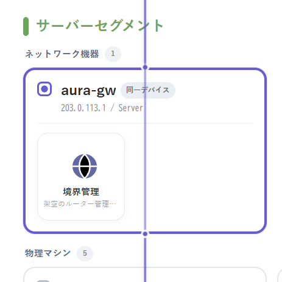

# 作業報告

## ユーザーからの依頼事項

- `contract-v1/README.md` の v1 実装ブリーフに従い、現行 Vite＋React SPA を
  localStorage 依存から REST API 駆動へ移行する。
- SQLite は `contract-v1/schema.sql` / `seed.sql` の台帳 v0.4 を使い、API は
  TypeScript＋Hono で実装する。認証は追加しない。
- Gatus 連携と Avahi は v1 の任意機能として実装せず、状態プロバイダ未接続時は
  GUI にサービス状態を表示しない。
- 生成スクリプトには触れない。
- ブリーフの検収項目に沿ってテストとビルドを実行し、結果と未決点を本報告書へ
  追記する。
- Xの参考画面をもとに、仕様を増やした「ouchi.local」ポータル画面を実装する。
- VMを物理デバイスへ所属させず、VM自身をネットワークへ所属させる。
- データモデルをデバイスとサービスに分け、VMはデバイスのVMフラグで表現する。
- 物理デバイスとVMをネットワーク直下に並列表示し、どちらにもサービスを配置できるようにする。
- 参考画面のアイコン表示、状態ドット、ネットワーク中心の階層表示を踏襲する。
- 「インターネット」を通常の編集可能なネットワークとして含める。
- Reactコンポーネントとして既存GUIへ埋め込める形にし、初期データはJSONで差し替え可能にする。
- ネットワーク、物理デバイス、VM、サービスを編集でき、localStorageへ保存する。
- 認証、Gatusとのライブ連携、サーバー設定変更は対象外。
- 現在のソース一式をGitへコミットする。
- 設計更新版の `README.md` と `portal-screen-v7.png` を現行モックへ反映する。
- 更新後のモックを起動する。
- 現在のおうちネットワーク構成をテストデータへ反映する。
- サービスタイルのラベルをアイコンの下へ配置する。
- サービスタイルのボタンを正方形に近い形状へ調整する。
- 「同一デバイス」バッジを選択時だけ表示する。
- 選択状態を示す「選択中」バッジを削除する。
- 関係ラベルをfrom側／to側の2つに分ける。
- 既存デバイスへ同一デバイスの別所属を追加した際にサービスが消える問題を修正する。
- 消失したサービスを初期データから再登録する。
- デバイス編集中に一定時間で強制的にデバイス名へフォーカスが戻る問題を修正する。
- 現在の変更一式をGitへコミットする。
- デバイスエリア全体をクリック可能にし、サービスタイルだけを操作対象から分離する。
- デバイス欄外のクリックで選択を解除する。
- ポータル外側のグレー領域クリックでも選択を解除する。
- デバイス領域クリック、サービス分離、欄外解除の変更一式をGitへコミットする。
- デバイスカードの最小横幅をサービス2個分に設定する。
- 右側余白を抑え、画面幅に応じて表示できるデバイス数を増やす。
- 可変グリッドと320px表示を含む変更一式をGitへコミットする。
- ネットワーク階層へ「ネットワーク機器」「物理マシン」「VM」のカテゴリーを追加する。
- カテゴリー階層追加の変更一式をGitへコミットする。
- デバイス選択時、関係するデバイス同士を線で結ぶ。
- 同一デバイスの複数表示同士も接続線で結ぶ。
- レビュー用のインスタンスを起動する。
- デモ最上部の灰色領域へ、ロゴ「家」、サービス名「ouchi.local」、ポータルのサブタイトルをまとめたタイトルを配置する。
- メニューの「管理」へ鍵アイコンを追加し、ログインが必要な見た目にする。ログイン機能自体は実装しない。
- 最上部の灰色余白が広く見えるため、タイトル上下の余白を詰める。
- サブタイトルをGitLabのログイン画面のようにページを開くたび交互に切り替える。
- 白いカードの左上へユーザー設定タイトルを表示し、管理画面から編集・保存できるようにする。デフォルトは「あなたのホームラボ」。
- ネットワーク表示では「インターネット」を常に最下位にし、pCloudやNotionなど外部SaaSを置く領域として扱う。
- 現在の変更一式をGitへコミットする。
- 関連性を接続線で表現できるため、無関係デバイスのグレーアウトを外す試作を行う。ロールバック可能な専用ブランチで検証する。
- 接続線が半透明のカード越しに見えないよう、線とカードのZオーダーを修正する。
- 試作では接続線のZオーダーを最前面へ変更する。
- グレーアウト廃止と接続線最前面化を採用し、製品版ではデフォルトでデバイスを選択しない。
- 接続線へマウスオーバーした際、関係するデバイス名とfrom／toラベルをツールチップ表示する。
- 独自ツールチップとブラウザ標準ツールチップの重複を解消し、接続線上でカーソル形状を変えない。
- ツールチップの下端をマウス位置のY座標へ合わせ、ポインタより上へ表示する。
- ツールチップ修正一式をGitへコミットする。
- `contract-v1/ADDENDUM-2.md` に従い、ポータルタイトルを `settings.title`
  へ保存し、管理画面から変更できるようにする。
- `GET /api/settings` / `PUT /api/settings` / `GET /api/portal` と
  YAML エクスポート／インポートで `title` を扱い、往復一致を検証する。
- タイトルの空文字・101文字以上・改行入力を拒否し、不正時は DB を変更しない。
- テストとビルドを実行し、結果と未決点を本報告書へ追記する。
- 更新した成果物を `成果物/v1/` へ同期する。

## 現状の概要報告

- 2026-11-21 の v1 実装依頼を受領し、ブリーフ、DB スキーマ v0.4、シード、
  `verify.py`、現行 SPA、既存テストを確認済み。
- 現行 SPA は `usePortalData.ts` が localStorage へ保存し、10秒ごとに
  サービス状態をランダム更新している。v1 では両方を廃止する。
- 現行データは v0.2 モック形式で、所属 IP が必須、関係ラベルが必須、
  サービスに編集可能な状態値を持つ。API 境界で v0.4 の DB 形式へ合わせる。
- v1 のバックエンドを `server/`、SQLite ファイルを `data/`（実行時生成）に
  置く構成で実装を開始した。`node:sqlite`、Hono、Node 用 Hono アダプタを使う。
- `node:sqlite` は Node.js 22.22.2 で利用可能。DB は WAL と
  `busy_timeout=5000ms` を起動時に設定する予定。
- メーターは秘密鍵の供給方法が未決定のため、v1 では API の形だけ実装し、
  対象外・取得不能時は `null` を返す。ランダム値や手入力ダミー値は使わない。
- Gatus は v1 では接続しないため、`GET /api/portal` はサービス状態を付与しない。
- v1 実装を完了した。SPA は `GET /api/portal` で初期化し、追加・更新・削除は
  REST API 成功後に台帳を再取得する。localStorage 保存とランダム状態更新は削除した。
- Hono サーバーは `server/`、SQLite アクセスは `server/db.ts`、SPA の API 境界は
  `src/portal/apiClient.ts` に分離した。Hono は `4.12.14`、
  `@hono/node-server` は `1.19.14`、Node.js は 22.22.2 を使用した。
- 起動方法は開発時に `npm run dev:api` と `npm run dev`、本番相当は
  `npm run build && npm start`。SPA と API は本番時に同一 Hono プロセスから配信する。
- DB の既定パスは `data/ouchi.sqlite`。初回起動時に schema.sql / seed.sql を適用し、
  `foreign_keys=ON`、`busy_timeout=5000ms`、WAL、`synchronous=NORMAL` を設定する。
- Dockerfile と compose.yaml を追加し、API＋SPA を1イメージ、DB を
  `/app/data` ボリュームに分離した。生成スクリプトは変更していない。
- REST API は portal、networks、devices、memberships、services、relations、
  関係トラバース、meters、settings、health を実装した。
- `GET /api/portal` のサービスは integer ID、DB 列、組み立て済み `url` /
  `monitorUrl` を返し、Gatus 未接続のため `status` フィールド自体を持たない。
- メーター API は秘密鍵未供給のため、現時点で
  `memoryPercent: null, diskPercent: null, available: false` を返す。
  SPA は対象デバイスに「未取得」を表示し、手入力欄とダミー値を削除した。
- カテゴリー `service`、NULL 所属IP、自由タグ／自由色、`fromLabel || tag` /
  `toLabel || tag` のラベル解決、ポート常時明示の URL 組み立てへ更新した。
- カテゴリー見出しはポータル上で所属0件なら非表示にし、管理画面の追加導線は残した。
- 成果物は `成果物/v1/demo/`、`成果物/v1/server/index.js`、
  `成果物/v1/package/ouchi-local-portal-1.0.0.tgz` に配置した。
- 検収結果: `npm test` は 3ファイル・33テスト成功。`npm run build` は
  型チェック、ライブラリ、SPA、Hono サーバービルドすべて成功。
  `python3 contract-v1/verify.py` は `RESULT: ALL OK`。
- `npm audit --offline` は脆弱性0件。`npm run screenshots` は実行環境が
  `127.0.0.1:4173` の bind を `EPERM` で拒否し、Playwright テスト本体へ到達できなかった。
  GUI の API 初期読込・API 経由のネットワーク追加・状態未接続表示・管理フォームは
  Vitest／jsdom で検証し、CRUD・関係・URLは Hono in-process テストで検証済み。
- 参考投稿の3枚の画面画像と、関連するSSO投稿画像を確認済み。
- RAGのIPアドレス命名ルールとGatusの登録サービスを確認済み。
- React＋TypeScript＋Viteで、埋め込み用ポータルコンポーネントとデモ画面を実装済み。
- 「インターネット」、`192.168.0.0/24`、`192.168.253.0/24` の3ネットワークを初期登録済み。
- ネットワーク、物理デバイス、VM、サービスの追加・編集・削除、入力検証、localStorage保存を実装済み。
- アイコン／リスト切替、10秒ごとの状態更新、レスポンシブ表示を実装済み。
- 自動テスト22件、型チェック、ライブラリ／デモの本番ビルドが成功済み。
- axe-coreによる構造アクセシビリティ検査が成功済み。
- Playwrightによる8状態の表示検証とスクリーンショット生成が成功済み。
- ビルド済みデモとnpmパッケージを `成果物/` に配置済み。
- 一時的な別プロジェクトへnpmパッケージを導入し、公開APIのimport確認が成功済み。
- ネットワーク直下に物理デバイスとVMを並列表示し、サービスを各ノードへ配置する構造へ変更済み。
- VMは物理デバイスを参照せず、ネットワークとIPだけを持ちます。
- 自動テスト22件、Playwrightの8表示状態が成功済み。
- VM対応版のnpmパッケージを成果物へ更新済み。
- NAT時もVMを任意のネットワークへ独立して所属させられます。
- 物理デバイスとVMを単一の `devices` データへ統合済み。
- VMは `isVm: true` のデバイスとして扱います。
- 管理画面はネットワーク／デバイス／サービスの3種類に整理済み。
- Gitコミット依頼を受領し、リポジトリ状態と追跡対象を確認済みです。
- コミット前の自動テスト22件とTypeScript型チェックが成功しました。
- 現在のソース一式を `main` ブランチへローカルコミット済みです。
- 設計更新版READMEと `portal-screen-v7.png` を基に、モックを `PortalDataV2` へ更新済みです。
- 複数ネットワーク所属を `deviceNetworks` で表現し、各所属レコードがアクセス用IPを持ちます。
- サービスは `deviceNetworkId` へ配置し、選択したIPが属するネットワーク表示にだけ表示します。
- 自由入力タグと色を持つ `relations`、同一デバイス表示、関係表示を別概念として実装済みです。
- メモリ／ディスクメーター、SSH接続メタデータ、CPU非表示を実装済みです。
- サービスURLとGatus監視URLをスキーム、IP、ポート、パスから生成できます。
- 自動テスト32件、Playwright11状態、型チェック、ライブラリ／デモビルドが成功済みです。
- npmパッケージを `0.2.0` へ更新し、デモ、パッケージ、9枚の画面確認画像を成果物へ配置済みです。
- 開発サーバーを `http://192.168.0.32:5173/` で起動し、HTTP 200応答を確認済みです。
- Gatusの監視APIから2026-11-20時点の登録ホストと成功状態を取得しました。
- RAGのIPアドレス命名ルール（commit `4be1dd9`）を確認しました。
- おうちLAN 9台、OCIネットワーク2台、管理・アプリサービス10件をテストデータへ反映済みです。
- Gatus登録ホストの管理URL候補へ読み取りアクセスし、主なスキームとポートを確認済みです。
- 実データ版でも自動テスト32件、型チェック、本番ビルド、Playwright 11状態が成功済みです。
- サービスタイルを縦配置へ変更し、アイコンの下へサービス名と補足名を表示します。
- サービスタイルを固定幅グリッドの正方形ボタンへ変更済みです。
- 同一デバイスを示すバッジは、同一IDのいずれかのノードを選択した場合だけ表示します。
- 選択状態は枠とラジオ表示だけにし、「選択中」テキストバッジを削除しました。
- 関係データを単一`tag`から`fromLabel`／`toLabel`へ変更しました。
- OMV→ACEMAGIC関係は、OMV側`VM`、ACEMAGIC側`親ホスト`として登録しています。
- デバイス保存時に他デバイスのサービスまで絞り込んで削除していた不具合を特定しました。
- 変更前の所属IPに紐づくサービスだけを整理し、他デバイスのサービスを保持するよう修正しました。
- 既に破損したlocalStorageを読み込まないよう、既定保存キーを`ouchi.local.portal.v9`へ更新しました。
- FortiGate管理画面を含む10サービスを再シードするため、既定保存キーを`ouchi.local.portal.v10`へ更新しました。
- ダイアログの初期フォーカス処理が、10秒ごとの状態更新による親再描画のたびに再実行されていました。
- フォーカス処理を初回マウント時だけに限定し、Escキーのハンドラは最新コールバックを参照するよう修正しました。
- 確認ダイアログでも同様に、再描画時にフォーカスが戻る問題を修正しました。
- Gitコミット対象の差分、テスト結果、成果物を確認済みです。
- 現在の変更一式を `main` ブランチへローカルコミット済みです。
- デバイスカード／リスト行のサービス以外の領域を、クリックで選択できるよう変更しています。
- デバイスカード／リスト行の外側をクリックすると選択を解除するよう変更しています。
- `.ouchi-portal`の外側をpointerdownした場合も選択を解除するよう変更しています。
- 最新のクリック操作修正、テスト32件、成果物、報告書をコミット対象として確認済みです。
- デバイス操作改善一式を `main` ブランチへローカルコミット済みです。
- デバイスカードを最小226pxとし、サービスボタンを常に最大2列で表示します。
- 320px幅でも横スクロールせず、サービス2個分を維持できることを確認済みです。
- 固定列数のデバイスグリッドを、226px以上のカードを自動配置する可変グリッドへ変更しました。
- デスクトップ1440pxで最大5列、タブレット768pxで2列表示となることを確認済みです。
- 最新のグリッド変更、Playwright 10状態、成果物、報告書をコミット対象として確認済みです。
- 可変グリッド変更一式を `main` ブランチへローカルコミット済みです。
- デバイスへ`category: network | physical | vm`を追加し、ネットワーク配下を3カテゴリーで表示します。
- アイコン／リスト両表示でカテゴリー見出しと件数を表示し、管理画面からカテゴリーを編集できます。
- 既定保存キーを`ouchi.local.portal.v11`へ更新し、カテゴリー必須データを初期データから読み込みます。
- 最新のカテゴリー機能、テスト32件、Playwright 10状態、成果物をコミット対象として確認済みです。
- カテゴリー階層追加一式を `main` ブランチへローカルコミット済みです。
- 選択中デバイスと関係先デバイスのカード座標を計測し、関係色のSVG曲線で結ぶ処理を追加しています。
- 複数ネットワーク表示にも対応し、画面スクロール・リサイズ時は線を再計算します。
- 同一`deviceId`の複数カードは青い実線、通常の関係は関係色の破線で区別します。
- レビュー用開発サーバーを `0.0.0.0:5173` で起動しました。
- `http://192.168.0.32:5173/` へのHTTPアクセスが `200 OK` を返し、ポータルのHTMLを確認済みです。
- 最上部の灰色領域へポータルのタイトルブロックを移し、白いカード内は表示切替とポータル本体に整理しています。
- タイトルはロゴ「家」、サービス名「ouchi.local」、サブタイトル「ポータル — おうちのサービスは、ここから全部入る」の3要素で構成しています。
- タイトル変更後、自動テスト32件、型チェック、ライブラリ／デモビルド、Playwright 11状態、320pxを含む5画面幅の表示検証が成功済みです。
- 管理ボタンへ紫の鍵バッジと「ログインが必要」の補助情報を追加しています。
- 最上部余白をデスクトップ54pxから34px、モバイル30pxから24pxへ縮めています。
- 鍵アイコンと余白調整後、自動テスト32件、型チェック、ライブラリ／デモビルド、Playwright 11状態が成功済みです。
- サブタイトルは「これがあなたのホームラボです」と「AIと創る、おうちネットワーク」を、ページを開くたび交互に切り替えます。
- 前回表示したサブタイトルをlocalStorageへ保存し、連続リロードでも同じ文言が続かないようにしています。
- サブタイトル切り替え後、自動テスト32件、型チェック、ライブラリ／デモビルド、Playwright 12状態が成功済みです。
- ユーザー設定タイトルはカード左上に表示し、ログインを想定した管理画面内から編集します。
- ネットワークの表示順を、インターネット以外を先、インターネットを最後に固定する処理を追加しています。
- タイトルのデフォルトは「あなたのホームラボ」で、管理画面の「タイトルを保存」から変更できます。
- タイトル変更後、自動テスト33件、型チェック、ライブラリ／デモビルド、Playwright 13状態が成功済みです。
- コミット前に成果物のデモとnpmパッケージを最新ビルドへ同期済みです。
- コミット `17dd53e` から `experiment/remove-unrelated-grayout` ブランチを作成し、無関係デバイスを通常表示する試作中です。
- 接続線はカードより背面に維持し、カード背景を不透明にして線がカード上へ透けないよう調整しています。
- 試作版は自動テスト33件、型チェック、ライブラリ／デモビルド、Playwright 13状態が成功済みです。
- 接続線SVGを`z-index: 2`へ変更し、カードより前面に表示するよう調整しています。
- 最前面化後、接続線のPlaywright表示検証2状態が成功済みです。
- 製品版では初期選択を指定せず、起動直後は選択・関係強調のない状態にします。
- 接続線には広めの透明ヒット領域とカスタムツールチップを追加しています。
- SVGの`title`要素を削除し、ブラウザ標準ツールチップが出ないようにしています。接続線ヒット領域の`cursor: help`も削除しています。
- ツールチップからデバイス名を外し、関係ラベルだけを`親ホスト⇒VMホスト`のように表示します。同一デバイス線は`同一デバイス`のみ表示します。
- ツールチップは右へ12pxずらし、下端がマウスY座標に一致するよう上方向へ配置しています。
- 最終状態で自動テスト33件、型チェック、ライブラリ／デモビルド、Playwright 13状態が成功済みです。
- 成果物のデモとnpmパッケージを最新ビルドへ同期済みです。
- 関係データの向きとラベルを更新したため、既定のlocalStorageキーを`ouchi.local.portal.v12`へ更新しています。
- 採用版は自動テスト33件、型チェック、ライブラリ／デモビルド、Playwright 13状態が成功済みです。
- 2026-11-21 の追加ブリーフ2を受領し、`settings.title` を含む更新済み契約
  (`DB_SCHEMA_DRAFT.md` / `schema.sql` / `seed.sql`) を確認しました。
- 現行 SPA ではタイトルが `App.tsx` のセッション内 state にあり、API 型・
  SQLite リポジトリ・YAML は `settings.domain` だけを扱っています。
- `settings.title` を API 型、ポータルスナップショット、YAML の
  `settings` オブジェクト、管理フォーム、タイトル表示まで一貫して接続する
  実装を開始しました。

## 課題、懸念点、質問事項

- ネットワーク削除は「紐づく所属が1件でもあれば削除不可」で実装し、API は
  `409 Conflict` を返す。ブリーフの未決事項であり、カイルの確認が必要。
- 追加ブリーフ2で `settings.title` を永続化する仕様に確定しました。
  既存 DB はエクスポート→インポートで移行し、自動 `ALTER TABLE` は実装しません。
- メーター収集用 SSH 秘密鍵の供給方法と収集間隔は未決。v1 では
  `GET /api/devices/:id/meters` が常に `null` を返す。
- Gatus API の接続方法は v1 の任意要件。本次実装では未接続とし、状態自体を
  API レスポンスへ含めない。
- API レスポンスは DB の整数 ID とし、現行 SPA の表示モデルへ変換する境界を
  設ける。既存コンポーネントの文字列 ID は画面内部でのみ使う。
- `contract-v1` はリポジトリで未追跡。生成スクリプトが含まれていないことを
  確認済みで、今回の実装では変更しない。
- なし。仕様は確定済み。
- 「インターネット」はCIDRを持たない通常ネットワークとして扱う。
- ブラウザ内モックのため、サーバー間の実データ同期は行わない。
- 作業ディレクトリの `.git` は中身が空だったため、新しいローカルリポジトリを初期化しました。
- リモートリポジトリは未設定です。今回の依頼範囲にはpushを含めていません。
- 複数ネットワーク所属は `deviceNetworks` の中間配列で表現し、デバイス本体から単一の `networkId` を外す方針です。
- 同一デバイスの複数IPへサービスを配置するため、所属情報へIPと一意なIDを持たせ、サービスから所属先IDを参照する方針へ更新しました。
- これにより、CIDRの異なるネットワークへ同じデバイスが所属しても、各ネットワーク用IPへサービスを個別配置できます。
- 同一デバイスの複数表示は `deviceId` の一致で判定し、関係ハイライトは `relations` の関係先と色で別管理します。
- v2はデータ形式がv1と非互換です。旧v1データは `PortalDataV2` への変換が必要です。
- 公開APIは `PortalDataV1` から `PortalDataV2` へ変更されています。
- openmediavaultのIP `192.168.0.21` は、RAGの物理サーバー帯 `11-20` と仮想マシン帯 `30-100` のどちらにも含まれません。
- GatusにWANアドレスがないため、「インターネット」ネットワークは所属ノードなしで保持しています。
- ProxmoxはACEMAGIC上の既存利用として登録しましたが、Gatusのアプリ監視一覧には独立項目がありません。
- 現在のサービスモデルは配置先にIPv4を要求するため、pCloudやNotionのようなURL・ホスト名ベースの外部SaaSを直接登録するには外部サービス用のデータ形式と管理UIが必要です。

## タスク一覧

### TODO

- 実ブラウザでの Playwright 検収（localhost bind 可能な環境で `npm run screenshots`）。
- メーター収集用 SSH 秘密鍵の供給方法・収集間隔の決定とコレクター実装。
- 必要になった場合の Gatus 状態プロバイダ接続。
- 既存 DB を新スキーマへ移行する際は、旧版でエクスポートした YAML を
  新版へインポートする運用が必要です（追加ブリーフ2の指定）。
- ouchi-test へのデプロイとリダイレクタ302の確認（カイル側担当）。
- 実ブラウザで接続線・ドット・ツールチップの前面順を確認する。

### 作業中

- なし。

### v1 完了

- v0.4 schema.sql / seed.sql による SQLite 台帳初期化。
- WAL、busy_timeout、外部キー有効化。
- Hono REST API の portal、CRUD、関係トラバース、meters、settings、health。
- SPA 初期表示の API 駆動化と編集操作の API 反映。
- localStorage 保存、ランダム状態更新、手入力メーターの削除。
- Gatus 未接続時の状態非表示とメーター未取得表示。
- カテゴリー service、NULL IP、自由タグ／色、方向別ラベルに対応。
- Dockerfile、compose.yaml、v1 成果物、README 更新。
- Vitest 33件、型チェック、SPA／ライブラリ／サーバービルド、verify.py 実行。

### 完了

- 参考画面と実環境情報の調査。
- 実装仕様の確定。
- React＋TypeScript＋Viteのプロジェクト基盤。
- ポータルコンポーネントとネットワーク・物理デバイス・VM・サービスの編集UI。
- JSON初期データ、localStorage保存、入力検証、ランダム状態更新。
- 単体・コンポーネント・アクセシビリティテスト22件と本番ビルド。
- Playwrightによる4画面幅、一覧表示、管理画面、サービス追加フォームの検証。
- デモ、埋め込みパッケージ、8枚のスクリーンショットの成果物配置。
- npmパッケージの外部プロジェクト導入確認。
- 物理デバイスとVMのネットワーク直下への並列表示、VMのCRUD、VM上へのサービス配置。
- VM独立所属版のアイコン／リスト表示、管理画面、入力検証、テスト、成果物更新。
- デバイス／サービスへのモデル統合と、デバイスのVMフラグ表示・編集。
- Gitコミット前のリポジトリ状態と追跡対象の確認。
- コミット前の自動テスト22件とTypeScript型チェック。
- 現在のソース一式のローカルGitコミット。
- 設計更新版READMEと `portal-screen-v7.png` の確認。
- `PortalDataV2` の型、バリデーション、localStorage保存形式。
- 複数ネットワーク所属と所属IP単位のサービス配置。
- 同一 `deviceId` の複数表示と全表示同期ハイライト。
- 自由文字列タグ、任意色、同一相手への複数タグを持つ汎用関係。
- 関係先の色付きハイライト、タグ表示、無関係デバイスのグレーアウト。
- アイコン／リスト両表示への複数所属、関係、メーター反映。
- デバイス管理画面での所属IP複数編集、SSH項目、メモリ／ディスク使用率編集。
- サービス管理画面での配置先IP、スキーム、ポート、トップパス、監視パス、任意URL編集。
- Explorer風矩形サービスタイルとレスポンシブ表示調整。
- 自動テスト32件、型チェック、ライブラリ／デモ本番ビルド。
- Playwrightによる11状態の表示検証とスクリーンショット生成。
- `ouchi-local-portal@0.2.0` のnpmパッケージ生成と成果物更新。
- READMEのデータモデル、関係仕様、URL生成、v1からの変更点の更新。
- 更新後モックの開発サーバー起動とHTTP応答確認。
- Gatus登録ホスト、グループ、IP、最新成功状態の取得。
- RAGの `192.168.0.0/24` アドレス帯ルール確認。
- おうちLAN 9ノード、OCIネットワーク2ノードへのテストデータ更新。
- FortiGate、WAC、スイッチ管理画面、Proxmox、Gitea、Gatus、openmediavaultのサービス登録。
- 実データ反映後のテスト、型チェック、ビルド、Playwright表示確認。
- READMEへの現在のテストデータと取得元の追記。
- サービスタイルのラベルをアイコン下へ配置するレイアウト調整。
- サービスタイルを正方形に近いボタンへ変更するレイアウト調整。
- 同一デバイスバッジの選択時限定表示。
- 「選択中」バッジの削除。
- 関係ラベルのfrom／to二方向化と関係編集フォーム更新。
- デバイス再保存時のサービス消失バグ修正と回帰テスト追加。
- 保存キー更新による正常な初期サービス一覧への復旧。
- 保存キー`v10`による10サービスの再登録。
- 編集ダイアログと確認ダイアログの初回限定フォーカス処理。
- 状態更新後も編集中フィールドのカーソルを維持する回帰テスト。
- Gitコミット前の差分、テスト、成果物確認。
- 現在の変更一式のローカルGitコミット。

---

## 2026-11-21 追加ブリーフ9：接続線のZオーダーを最前面に戻す

### ユーザーからの依頼事項

- `contract-v1/ADDENDUM-9.md` を読み、接続線がカードの後ろに描画される原因を
  特定する。追加ブリーフ8の変更が影響したかも明記する。
- 接続線と接続点を、カードを含むポータル内の全要素より前面へ戻す。
- 線の太さ・不透明度は現行の見た目を維持し、カード上の可読性を悪化させない。
- 接続線ツールチップは線よりさらに前面に維持する。
- 選択ハイライト（カードのリング等）の見え方を崩さない。
- APIモードとYAMLモードが共有するポータル共通コンポーネントへ適用する。
- 既存テストを全件実行し、ビルド後に `成果物/v1/` と
  `成果物/demo-pages/` を再同期する。
- 実ブラウザで確認できない場合は、その制約と代替確認を報告する。

### 現状の概要報告

- 追加ブリーフ8で、カード本体を線が突き抜けないよう
  `connectorCardMasks()` とSVG `<mask>` を導入していた。
- 線レイヤー自体は `z-index: 2`、カードを含むスタックは `z-index: 1` で、
  CSS上のZオーダーでは線が前面だった。しかしマスク内の全カード内部を
  黒で塗りつぶしていたため、カードと交差する線・接続点だけがSVG描画時に
  消去され、カードの背面に回ったように見えていた。
- したがって回帰原因は追加ブリーフ8のカードマスクであり、Zオーダー値の
  逆転ではない。追加ブリーフ9の採用仕様に合わせ、マスクによるカード内部の
  除外を廃止し、線を見た目どおり全カードの前面に描画する方針とした。

### 修正内容

- 共通コンポーネント `OuchiPortal.tsx` からSVG `<mask>`、カード内部マスク、
  マスク状態を削除し、接続線・接続点を無マスクの単一SVGレイヤーへ戻した。
- 不要になった `connectorCardMasks()` を削除した。接続点の上下左右選択を
  行う `connectorAnchors()` はそのまま維持している。
- `.ouchi-canvas` にカード `1`、接続線 `20`、ツールチップ `21` のレイヤー値を
  定義し、`isolation: isolate` でポータル内の重なり順を明確化した。
- ツールチップは接続線より1段前面のままとした。管理ドロワー／ダイアログは
  従来どおりポータルcanvas外の独立レイヤー（`z-index: 1000` 以上）にある。
- 線の太さと不透明度は変更していない。関係線は2.5px・不透明度0.82、
  同一デバイス線は2px・不透明度0.62、ホバー時は3.5px・不透明度1の現行値。
- APIモードとYAMLモードは同じ `OuchiPortal` を利用するため、両方へ同時に適用
  される。読み取り専用YAMLデモにも管理UI以外の描画変更はない。
- コンポーネント回帰テストを「カード内部をマスクする」から
  「カード位置で線をマスクしない」へ更新した。
- E2E検証を、線レイヤー`20`、ツールチップ`21`、マスク0件、選択リング3px、
  aura-gwの同一デバイス線が別カードと交差する位置で最前面要素が線であること、
  線の太さ・不透明度が現行値であることを確認する内容へ更新した。

### テスト・ビルド結果

- `npm test -- --reporter=verbose`: 成功。6ファイル、55テスト。
- `npm run typecheck`: 成功。
- `npm run build`: 成功。型チェック、Reactライブラリ、SPA、Honoサーバーを
  すべて再ビルドした。
- `npm run build:pages`: 成功。YAMLモードのPages用デモを
  `成果物/demo-pages/` へ再生成した。
- `python3 contract-v1/verify.py`: `RESULT: ALL OK`。外部キー、件数、
  カテゴリー不変条件、関係トラバース、全サービスURLを再確認した。
- ビルド済みCSSで `--ouchi-card-layer: 1`、`--ouchi-connector-layer: 20`、
  `--ouchi-tooltip-layer: 21` を確認した。ビルド済みSPA／ライブラリから
  カードマスクの生成コードが除去されていることも確認した。
- `npm run screenshots`: `127.0.0.1:4173` のlistenが `EPERM` となり、
  Honoサーバーを起動できなかったためPlaywright本体は未実行。
- Chromium実行ファイルは存在するが、localhostを使わない `file://` の直接起動も
  ブラウザプロセスが `SIGTRAP` で終了し、サンドボックスに拒否された。
  そのため実ブラウザのスクリーンショットによる目視確認は未実施。
- 代替確認として、jsdomコンポーネントテストでカードマスクが生成されないこと、
  E2E定義でaura-gwの線がカード交差位置の最前面要素であること、選択リングと
  ツールチップの前面順を機械検証できるよう回帰条件を追加した。
- カード文字上の可読性は線の太さ・不透明度を現行値から変更していない。
  ただし実ブラウザでの目視評価は上記制約により未完了。
- `demo-dist/`、`dist/`、`server-dist/` と `成果物/v1/` の対応物を
  `diff -qr` / `cmp` で比較し一致を確認した。`成果物/demo-pages/` は
  `npm run build:pages` で直接再生成した。
- npmパッケージ `ouchi-local-portal-1.0.0.tgz` を再生成し、
  `成果物/v1/package/` へ同期した。収録33ファイル、package size 91.4kB。

### 課題、懸念点、質問事項

- サンドボックスのlocalhost bind拒否とChromium起動拒否により、最終的な
  実ブラウザ目視・Playwright実行が未完了。bind可能な環境で
  `npm run screenshots` を再実行する必要がある。
- 実ブラウザ未確認に伴い、カード文字と線が重なる箇所の最終的な見やすさ、
  および選択リングの目視評価だけが残る。CSS値と前面順の回帰条件は確認済み。
- 実装上の未決事項・追加質問はない。

### タスク一覧

#### TODO

- localhost bindとChromium起動が可能な環境で `npm run screenshots` を実行し、
  aura-gw交差位置・ツールチップ・選択リング・可読性を実ブラウザで目視確認する。

#### 作業中

- なし。

#### 完了

- `contract-v1/ADDENDUM-9.md` と追加ブリーフ8の実装差分の確認。
- カードマスクが線を消去していた回帰原因の特定。
- SVGマスクとマスク生成処理の削除。
- カード1、接続線20、ツールチップ21の明示的なレイヤー定義。
- 接続線・接続点の無マスク描画と、ツールチップ最前面維持。
- APIモード／YAMLモード共通コンポーネントへの適用。
- マスク廃止、レイヤー、カード交差、選択リング、ツールチップの回帰条件追加。
- 6ファイル・55テスト、型チェック、通常ビルド、Pagesビルド、verify.py。
- `成果物/demo-pages/` と `成果物/v1/` の再生成・再同期・一致確認。

---

## 既存作業の完了履歴（続き）

- グレーアウト除外試作用の専用Gitブランチ作成。
- 接続線がカード越しに透けないZオーダー調整。
- グレーアウト除外試作の全自動テスト、ビルド、表示検証。
- 接続線をカードより前面へ移動するZオーダー変更。
- 最前面化した接続線のPlaywright表示検証。
- グレーアウト廃止と接続線最前面化の採用。
- デフォルト無選択の製品仕様化。
- 接続線ホバー時の関係文字列ツールチップ。
- 接続線ツールチップのPlaywright表示検証。
- 採用版の成果物同期、製品版ビルド、全回帰テスト。
- ブラウザ標準ツールチップの無効化とカーソル変更の削除。
- 簡潔な関係ラベルとツールチップY座標調整。
- ツールチップ修正一式のコミット前検証と成果物同期。
- デバイス領域クリックとサービスタイル分離の回帰テスト。
- 欄外クリックによる選択解除の回帰テスト。
- ポータル外側クリックによる選択解除の回帰テスト。
- デバイス操作改善一式のGitコミット前確認。
- デバイス操作改善一式のローカルGitコミット。
- サービス2個分のデバイスカード最小幅調整。
- 320px幅での横スクロールなし検証。
- デバイスカードの自動可変列化による表示密度調整。
- 可変グリッド変更一式のGitコミット前確認。
- 可変グリッド変更一式のローカルGitコミット。
- ネットワーク階層の3カテゴリー表示。
- デバイスカテゴリー編集と`isVm`整合性バリデーション。
- カテゴリー見出しのアクセシビリティ調整。
- カテゴリー階層追加一式のGitコミット前確認。
- カテゴリー階層追加一式のローカルGitコミット。
- 関係デバイス間のSVG接続線とレスポンシブ再計算。
- 同一デバイス複数表示間のSVG接続線。
- レビュー用開発サーバーの起動とHTTP応答確認。
- 最上部の灰色領域へのタイトル移動。
- タイトル変更後の自動テスト、ビルド、Playwright表示検証。
- 管理ボタンへの鍵アイコンとログイン必要表示。
- 最上部の灰色余白調整とレスポンシブ表示確認。
- ページ読み込みごとのサブタイトル切り替え。
- サブタイトル切り替えの連続リロード回帰テスト。
- 白いカード左上へのユーザー設定タイトル表示。
- 管理画面からのタイトル編集とlocalStorage保存。
- タイトルデフォルト値「あなたのホームラボ」への変更。
- インターネットを最下位にするネットワーク表示順。
- アイコン／リスト／管理画面／選択フォームでの共通ソート。
- コミット前の成果物同期と差分確認。
- 現在の変更一式のローカルGitコミット。

---

## 2026-11-21 追加ブリーフ1：設定の YAML エクスポート／インポート

### ユーザーからの依頼事項

- `contract-v1/ADDENDUM-1.md` と `contract-v1/README.md` 第7節を確認する。
- 設定一式を YAML でエクスポート／インポートできるようにする。
- 参照は DB の内部 ID ではなく自然キーを使う。
- インポートは全件バリデーションを通してから、トランザクションで全置き換えする。
- 不正な YAML／不正データでは DB を一切変更しない。
- export → 別 DB へ import → 再 export のラウンドトリップを検収する。
- 管理画面にダウンロードと、内容確認を挟んだインポート導線を追加する。
- 完了後にテストとビルドを実行し、結果と未決点を本報告書へ追記する。

### 現状の概要報告

- `GET /api/export` と `POST /api/import` を追加した。エクスポートは
  `application/yaml` とダウンロード用ファイル名を返す。
- YAML は `format: ouchi-ledger/1` と `exportedAt` を持ち、settings、
  networks、devices（memberships 内包）、relations、services、sshKeys、
  deviceKeys を含む。DB の整数 ID は出力しない。
- 所属は hostname＋network name、サービスは device＋network、関係は
  from＋to の hostname、デバイス鍵は device＋公開鍵で参照する。サービスは
  `favicon_url` も含めて既存 DB 列を保持する。
- インポートは YAML 構文、形式版、必須項目、既存の network／device／
  membership／relation／service payload 検証、自然キー重複、参照解決、
  CIDR 内 IP、IP 重複、カテゴリーと VM／メーターの整合性を全件確認する。
- 検証成功後に `BEGIN IMMEDIATE` を開始し、全台帳テーブルを削除して自然キーから
  ID を振り直して再構築する。挿入中の例外は `ROLLBACK` する。
- 管理画面へ「YAMLをエクスポート」とファイル選択を追加した。選択後は内容の
  先頭3,000文字、文字数、全置き換え警告を表示し、利用者が
  「内容を確認して全置き換え」を押すまで API を呼ばない。
- API クライアントと管理画面の移行 UI を追加し、インポート成功後は台帳を再取得する。
- YAML パーサーとして `yaml@2.9.0` を追加した。ネイティブ依存は増えていない。
- ビルド済みデモ、Hono サーバービルド、npm パッケージを `成果物/v1/` へ同期した。

### テスト・ビルド結果

- `npm run typecheck`: 成功。
- `npm test`: 3ファイル、37テスト成功（追加前33件から4件追加）。
- export の YAML 形式、内部 ID／派生 URL の非出力、自然キー参照を確認。
- seed 台帳へ SSH 公開鍵と device_keys を追加し、別 SQLite DB へ import 後、
  `exportedAt` を除く再 export が完全一致することを確認。
- import 後の ID 再割当後も、自然キーから memberships、services、relations が
  再構成されることを確認。
- 壊れた YAML と存在しないデバイス参照で HTTP 400 となり、前後の
  `GET /api/portal` が完全一致することを確認。
- 管理画面の export ダウンロード、ファイル内容プレビュー、警告、確認後の POST、
  成功表示をコンポーネントテストで確認。
- `npm run build`: 成功。型チェック、埋め込みライブラリ、SPA、Hono サーバーを
  すべて再ビルドした。
- `python3 contract-v1/verify.py`: `RESULT: ALL OK`。件数、外部キー、
  service-category 不変条件、関係トラバース、全サービス URL を確認。
- `npm ls yaml --depth=0`: `yaml@2.9.0` を確認。
- `git diff --check`: 空白エラーなし。
- ビルド済み `server-dist/index.js` に `/api/export`、`/api/import`、
  `ouchi-ledger/1` が含まれることを確認。
- 本番起動を一時 DB で試したが、実行環境が `0.0.0.0:31873` の listen を
  `EPERM` で拒否した。既知のサンドボックス制約であり、エクスポート／
  インポート自体は Hono の in-process テストで実行済み。

### 課題、懸念点、質問事項

- 今回の追加分について未実装の機能はない。
- ポータル表示タイトルは現行 `settings` スキーマに列がないため、YAML の
  settings には含まれない。DB 永続化するかは従来からの未決事項。
- ネットワーク削除を「所属が残る場合は削除不可」としている点は、引き続き
  カイルの確認待ち。
- device_keys の自然キーには、DB で一意制約がある公開鍵本文を使う。
  フィンガープリントのみを鍵の識別子にしたい要件が出た場合は形式版の拡張が必要。
- ブラウザ上で実サーバーを伴う最終操作確認は、この実行環境の bind 制限のため
  未実施。localhost bind 可能な環境で管理画面のファイル選択とダウンロードを
  最終確認する余地がある。

### タスク一覧

#### TODO

- localhost bind 可能な環境で、ブラウザから管理画面の YAML export／import を
  E2E 確認する。
- ポータル表示タイトルを settings に保存するか決定する。
- ネットワーク削除ルールについてカイルの確認を得る。

#### 作業中

- なし。

#### 完了

- 追加ブリーフと README 第7節の確認。
- YAML 形式 `ouchi-ledger/1` と自然キー schema の実装。
- `GET /api/export`、`POST /api/import` の実装。
- 全件検証後の `BEGIN IMMEDIATE` 全置き換えとロールバック実装。
- settings、全ネットワーク、デバイス／所属、関係、サービス、SSH 鍵の往復。
- 管理画面の export ダウンロード、内容プレビュー、警告付き import UI。
- ラウンドトリップ、ID 再割当、不正時 DB 無変更の自動テスト。
- 全 37 テスト、型チェック、SPA／ライブラリ／サーバービルド、verify.py。
- README の API／YAML 移行仕様更新。
- `成果物/v1/` のデモ、サーバー、npm パッケージ同期。

---

## 2026-11-21 追加ブリーフ2：ポータルタイトルの設定値化

### ユーザーからの依頼事項

- `contract-v1/ADDENDUM-2.md` を読み、更新済みの `settings.title` 契約に従う。
- ポータルタイトルを `settings.title` に保存し、管理画面から変更可能にする。
- `GET /api/settings` / `PUT /api/settings` / `GET /api/portal` で `title` を扱う。
- 空文字、100文字超、改行入力を HTTP 400 とし、DB を変更しない。
- YAML の settings に `domain` と `title` を含め、往復一致を検証する。
- テストとビルドを実行し、結果と未決点を本報告書へ追記する。
- 成果物を `成果物/v1/` へ同期する。

### 現状の概要報告

- `settings.title` を共有型 `PortalSettings`、API スナップショット、SQLite
  リポジトリ、API クライアント、GUI、YAML に一貫して追加した。
- `GET /api/settings` と `GET /api/portal` は `{ domain, title }` を返す。
  `PUT /api/settings` はタイトルを trim して保存し、更新後の設定を返す。
- タイトル検証は GUI と API で `validation.ts` を共有する。空白のみ、
  改行を含む値、100文字超は HTTP 400 となり、DB 更新前に拒否される。
- セッション内タイトル state と `portalTitle` / `onPortalTitleChange` の
  表示専用 props を廃止した。保存は管理画面から `PUT /api/settings` を呼び、
  成功後に `/api/portal` を再取得する経路だけにした。
- 管理画面の「ポータルタイトル」入力を domain と同じ設定欄に配置し、
  保存中表示と API エラー表示を追加した。ポータルのタイトル表示は
  再取得後の `settings.title` を使う。
- YAML の `settings` に `domain` と `title` を必ず含め、エクスポート、検証、
  全置き換えインポート、再エクスポートのすべてで保持する。
- 既存 DB の列追加は行わない。追加ブリーフ2の指定どおり、既存 DB は旧版で
  エクスポートし、新版へインポートする移行を前提とする。
- README の API、設定、YAML、SPA、未決事項を新しい契約へ更新した。
- ビルド済み SPA、Hono サーバー、React ライブラリ、型定義、npm パッケージを
  `成果物/v1/` へ同期した。各生成物の SHA-256 が同期元と一致することを確認した。

### テスト・ビルド結果

- `npm run typecheck`: 成功。
- `npm test`: 3ファイル、41テスト成功。
- title の初期値、GET／PUT、trim、SQLite 再オープン後の保持、
  `/api/portal` への反映を確認した。
- 空文字、101文字、改行入り title が 400 となり、前後の settings が
  完全一致することを確認した。
- GUI が API の title を表示し、管理画面の保存で `PUT /api/settings` を
  呼び、再取得後の title と成功メッセージを表示することを確認した。
- YAML export の settings、別 DB への import、title を含む再 export の
  往復一致を回帰テストへ追加した。
- `npm run build`: 成功。型チェック、埋め込みライブラリ、SPA、Hono サーバーを
  すべて再ビルドした。
- `python3 contract-v1/verify.py`: `RESULT: ALL OK`。外部キー、件数、
  カテゴリー不変条件、関係トラバース、全サービス URL を再確認した。
- `git diff --check`: 空白エラーなし。
- `npm run screenshots`: Vitest 後のブラウザ検証中、実行環境が
  `127.0.0.1:4173` の listen を `EPERM` で拒否したため、Playwright
  テスト本体へ到達できなかった。タイトル保存・リロード保持の E2E ケースは
  追加済みで、localhost bind 可能な環境で再実行が必要。

### 課題、懸念点、質問事項

- 実装上の未決点はない。
- 既存 DB は旧版で YAML エクスポート後、新版へインポートする必要がある。
  新コードは旧 DB に対して自動 `ALTER TABLE` を行わない。
- Playwright は実行環境の localhost bind 制約 `EPERM` により未完了。
- ネットワーク削除ルールについての従来のカイル確認待ちは、本次変更の
  範囲外として継続する。

### タスク一覧

#### TODO

- localhost bind 可能な環境で `npm run screenshots` を実行し、管理画面から
  タイトル保存後のリロード保持を実ブラウザで確認する。
- ouchi-test の既存 DB は旧版エクスポート→新版インポート手順で移行する。
- ネットワーク削除ルールについてカイルの確認を得る。

#### 作業中

- なし。

#### 完了

- 追加ブリーフ2と更新済み schema／seed／DB ドラフトの確認。
- `settings.title` の型、API、SQLite、GUI、YAML への実装。
- `GET /api/settings` / `PUT /api/settings` / `GET /api/portal` の title 対応。
- 空文字・改行・100文字超の 400 検証と DB 無変更テスト。
- 管理画面タイトル入力、API 保存、再取得、エラー表示。
- セッション内タイトル state と表示専用 props の廃止。
- YAML settings の title エクスポート／インポート／往復一致テスト。
- README 更新。
- 3ファイル・41テスト、型チェック、SPA／ライブラリ／サーバービルド。
- `verify.py` の `RESULT: ALL OK`。
- `成果物/v1/` のデモ、サーバー、ライブラリ、型定義、npm パッケージ同期。

## 追加ブリーフ3対応（メーター・状態ドット削除）

### ユーザーからの依頼事項

- `contract-v1/ADDENDUM-3.md` に従い、v1 GUI からデバイスカードのメーター
  表示（パーセンテージと「未取得」）および管理画面のメーター関連表示・入力を
  削除する。
- サービス状態ドット、状態ラベル、凡例、プレースホルダ等のGUI上の名残を
  削除する。
- `GET /api/devices/:id/meters`、台帳の SSH 関連列、状態プロバイダの
  差し込み設計は残す。
- テストとビルドを実行し、結果と未決点を本報告書へ追記する。
- 成果物を `成果物/v1/` へ同期する。

### 現状の概要報告

- ポータルのデバイスカードからメーター要素と「未取得」表示を削除した。
- サービスカード、デバイスカード、リスト表示、管理画面から状態ドット、
  状態ラベル、状態凡例を削除した。プロバイダが `status` を返してもGUIには
  表示しない回帰テストへ置き換えた。
- 管理画面のデバイス説明から「資源使用率」を削除し、SSH入力は接続情報として
  残した。「SSHリソース収集」「SSH計測」などメーター用途を示す文言と計測設定は
  表示しない。SSH接続情報の編集で非表示の `meterEnabled` は変化させず、
  既存値の保持または新規時の `false` とする。
- サービス編集画面から状態プロバイダの説明文を削除した。
- 型の `PortalStatus`、API クライアントの `status` 取り込み、メーターAPI、
  SQLite の SSH 関連列は維持している。
- README のメーター・状態表示の説明を v1 の実装に合わせて更新した。
- ビルド済み SPA、Hono サーバー、React ライブラリ、型定義、npm パッケージを
  `成果物/v1/` へ同期した。`diff -qr` とパッケージ内 `dist/` の
  ファイル比較で一致を確認した。

### テスト・ビルド結果

- `npm run typecheck`: 成功。
- `npm test`: 3ファイル、42テスト成功。
- プロバイダが `up` / `down` を返しても、状態ドット・状態凡例・状態ラベルを
  GUI に表示しないことを確認した。
- デバイスデータにメモリ／ディスク使用率があっても、デバイスカードに
  パーセンテージ・「未取得」・メーター要素を表示しないことを確認した。
- 管理画面で SSH ユーザーを編集でき、メーター／使用率／SSHリソース収集の
  入力や説明を表示しないことを確認した。
- サービス追加画面に状態プロバイダの説明と初期状態入力がないことを確認した。
- `GET /api/portal` がサービス `status` を返さず、
  `GET /api/devices/:id/meters` が従来どおり `null` のメーター応答を返す
  API テストが成功した。
- `npm run build`: 成功。型チェック、埋め込みライブラリ、SPA、Hono サーバーを
  すべて再ビルドした。
- `python3 contract-v1/verify.py`: `RESULT: ALL OK`。
- `git diff --check`: 空白エラーなし。
- 生成済み `dist` / `demo-dist` / `server-dist` に、削除対象の「未取得」、
  「SSHリソース収集」、「状態の凡例」、関連 CSS クラスが残っていないことを
  確認した。
- `npm run screenshots`: 実行環境が `127.0.0.1:4173` の listen を
  `EPERM` で拒否したため、Playwright テスト本体へ到達できなかった。
- Playwright の検証定義は5画面幅＋8フローの計13テストで、状態数に変更はない。
  5画面幅の検証へ状態・メーターUIが0件であることの確認を追加済みだが、
  localhost bind 制約のため実ブラウザ実行とスクリーンショット更新は未完了。

### 課題、懸念点、質問事項

- localhost bind 可能な環境で Playwright 13テストを再実行する必要がある。
- 既存 DB のデータ移行と、メーター収集用 SSH 秘密鍵・収集間隔は従来どおり
  未決。

### タスク一覧

#### TODO

- localhost bind 可能な環境で `npm run screenshots` を実行する。
- メーター収集用 SSH 秘密鍵の供給方法・収集間隔を決定する。
- 将来ブロックで Gatus 等の状態プロバイダを接続する。

#### 作業中

- なし。

#### 完了

- 追加ブリーフ3の確認。
- ポータル、管理画面、状態凡例からの対象表示削除。
- 状態プロバイダが値を返す場合もGUIに状態UIを出さない回帰テスト。
- メーター値が存在する場合もGUIにメーターUIを出さない回帰テスト。
- メーターAPI、SSH関連列、状態プロバイダ型・API境界の維持確認。
- README と報告書の更新。
- 3ファイル・42テスト、型チェック、SPA／ライブラリ／サーバービルド。
- `verify.py` の `RESULT: ALL OK` と `git diff --check`。
- `成果物/v1/` の SPA、サーバー、ライブラリ、型定義、npm パッケージ同期と
  一致確認。

---

## 2026-11-21 追加ブリーフ4：Apache-2.0 ライセンスの適用

### ユーザーからの依頼事項

- `contract-v1/ADDENDUM-4.md` を読み、プロジェクトへ Apache-2.0 ライセンスを
  適用する。
- `contract-v1/LICENSE` を内容を改変せずリポジトリ直下へコピーする。
- `package.json` の `license` を SPDX 識別子 `Apache-2.0` に設定する。
- README に「Apache License 2.0」と LICENSE へのリンクを含むライセンス節を
  追加する。
- Docker イメージ、npm パッケージ、`成果物/v1/` にも LICENSE を含める。
- 完了後にテストとビルドを実行し、結果と未決点を本報告書へ追記する。
- 成果物を `成果物/v1/` へ同期する。

### 現状の概要報告

- 追加ブリーフ4と Apache 公式ライセンス文面を確認した。
- `contract-v1/LICENSE` をリポジトリ直下へコピーした。コピー元とコピー先の
  SHA-256 はどちらも
  `47cd8e89c1b549f943c86c4753bb13d7f0def07d87d5d1c542a3319bc7378472`。
- `package.json` の `license` を `Apache-2.0` に設定し、lockfile のルート
  パッケージ情報にも同じ識別子を反映した。配布対象として `files` に
  `LICENSE` を明示した。
- README 末尾へ「ライセンス」節を追加し、Apache License 2.0 と LICENSE への
  相対リンクを記載した。
- Docker runtime ステージへ LICENSE をコピーする処理を追加した。
- npm tarball を再生成し、LICENSE、README、`dist/`、package.json の
  27エントリを収録した。
- ビルド済み SPA、React ライブラリ、型定義、Hono サーバー、LICENSE を
  `成果物/v1/` へ同期した。

### テスト・ビルド結果

- `npm test`: 成功。3ファイル、42テスト。
- `npm run build`: 成功。TypeScript 型チェック、React ライブラリ、SPA、
  Hono サーバーの全ビルドが完了した。
- `python3 contract-v1/verify.py`: `RESULT: ALL OK`。
- `npm install --package-lock-only --ignore-scripts --offline`: 成功。
  lockfile を更新し、脆弱性0件。
- `npm pack --dry-run --json` と実 tarball の双方で LICENSE を確認した。
  実 tarball は `成果物/v1/package/ouchi-local-portal-1.0.0.tgz`。
- tarball 内 package.json の `license` は `Apache-2.0`。tarball 内 README に
  ライセンス節があり、LICENSE は元ファイルと SHA-256 が一致した。
- `成果物/v1/LICENSE` と `contract-v1/LICENSE` は `cmp` 一致。
- `dist/`、`demo-dist/`、`server-dist/index.js` は `成果物/v1/` の対応物と
  `diff -qr` / `cmp` で一致した。
- `git diff --check`: 空白エラーなし。
- Dockerfile は build ステージの `/app/LICENSE` を runtime の `/app/LICENSE`
  へコピーする。`.dockerignore` は LICENSE を除外しておらず、build context に
  含まれることを確認した。
- Docker イメージの実ビルドは、実行環境の Docker API 接続が
  `permission denied` となったため未実施。Podman も `/run/libpod` が
  read-only のため実行できなかった。

### 課題、懸念点、質問事項

- ライセンス適用自体の未決点はない。`contract-v1/LICENSE` は無改変で、
  npm tarball と `成果物/v1/` の収録も確認済み。
- Docker runtime イメージ内の `/app/LICENSE` は Dockerfile のコピー定義と
  build context で確認したが、実イメージの起動確認だけは実行環境の
  コンテナランタイム制約により未完了。
- 実運用依存は `yaml` が ISC、`hono` と `@hono/node-server` が MIT で、
  すべて permissive。lockfile 全体には開発依存として `MPL-2.0`（axe-core）、
  `CC-BY-4.0`（caniuse-lite）、BlueOak-1.0.0 なども含まれるが、
  runtime は `npm ci --omit=dev`、npm tarball は `dist/` と LICENSE のみのため
  配布コードには含まれない。ライセンス競合は検出されていない。
- 現時点でユーザーへの追加質問はない。

### タスク一覧

#### TODO

- Docker runtime イメージをビルドし、`/app/LICENSE` の実体を確認する。

#### 作業中

- なし。

#### 完了

- 追加ブリーフ4と既存 LICENSE、package、README、Dockerfile、成果物構成の確認。
- `contract-v1/LICENSE` のリポジトリルートへの無改変コピーとハッシュ一致確認。
- `package.json` / `package-lock.json` の `Apache-2.0` 設定。
- npm `files` への LICENSE 明示。
- README ライセンス節追加。
- Docker runtime ステージへの LICENSE コピー定義追加。
- 3ファイル・42テスト、型チェック、React ライブラリ／SPA／サーバービルド。
- `verify.py` の `RESULT: ALL OK`、lockfile 更新、`git diff --check`。
- npm tarball の LICENSE・ライセンスメタデータ・README ライセンス節確認。
- `成果物/v1/` への LICENSE、SPA、React ライブラリ、型定義、サーバー、
  npm tarball の同期と一致確認。

---

## 2026-11-21 追加ブリーフ5：Docker ベースイメージの Alpine 化

### ユーザーからの依頼事項

- `contract-v1/ADDENDUM-5.md` に従い、Dockerfile の build / runtime 両ステージを
  `node:22-bookworm-slim` から `node:22-alpine` へ変更する。
- Alpine 上で `npm ci`（build / runtime）、`npm run build`、テストが通ることを
  確認する。
- Alpine（musl）上で `node:sqlite` を実際に使い、サーバー起動、DB 初期化、
  API の基本応答まで確認する。
- `node` ユーザー実行と `/app/data` の所有権が従来どおり機能することを確認する。
- 変更前後の Docker イメージサイズを実測し、arm64 / amd64 のマルチアーキ
  状況も確認する。
- compose.yaml への影響を確認し、必要なら修正する。
- 結果と未決点を本報告書へ追記し、成果物を `成果物/v1/` へ同期する。

### 現状の概要報告

- 追加ブリーフ5、現行 Dockerfile、compose.yaml、package scripts、既存報告を
  確認した。現行 Dockerfile は build / runtime とも
  `node:22-bookworm-slim` で、runtime は `USER node` と `/app/data` を使う。
- 追加ブリーフ受領時点の Dockerfile を
  `/tmp/ouchi-alpine-check/Dockerfile.bookworm` へ保存した。変更前 SHA-256 は
  `6e8a2b51bdaddadfd9879c831e0de72992b50d90523b8a608a1dd65d07509018`。
- Dockerfile の build / runtime 両ステージを `node:22-alpine` へ変更した。
  変更後 SHA-256 は
  `e65f1c81f04355f81ef7c6b3123c2fde7dff09b11e41d156e119b41052d2c40b`。
- README の Docker 節にも、build / runtime が `node:22-alpine` で、プロセスが
  `node` ユーザーで動くことを追記した。
- compose.yaml はベースイメージ、プラットフォーム、ユーザー、データパスを
  上書きしていないため変更不要と判断した。`docker compose config` は成功し、
  `ouchi-data:/app/data` と `3000:3000` の構成が維持されていることを確認した。
- 実行環境の Docker API は `permission denied` のため、Docker による
  イメージビルド、`docker images`、実 arm64 ビルドは実行できなかった。
- ローカルに展開済みの Alpine 3.23.3 ベース層と Node.js 22.22.1 musl
  バイナリを使い、実 musl Node で clean install、ビルド、テスト、SQLite、
  API の代替確認を行った。`process.report` の
  `glibcVersionRuntime` は `null` で、実際に glibc を使っていないことを確認した。

### テスト・ビルド結果

- build ステージ相当の clean install:
  - `npm ci`: 171 packages を導入して成功。
  - 実行環境のシークレットサンドボックスは、子プロセスが exit 0 でも
    `spawnSync` に `EPERM` を付ける。esbuild の投稿インストールはこの環境固有の
    偽エラーを検出した。検証用 preload で `status=0` かつ `EPERM` の場合だけ
    サンドボックス由来のエラーを除去すると、`npm ci` は終了コード 0 で完了した。
    この preload はリポジトリへ追加していない。
  - esbuild の実バイナリは同じ sandbox 上でも終了コード 0、`0.28.2` を返した。
  - musl 用 `@rollup/rollup-linux-x64-musl` が導入され、ビルドで使用された。
- runtime ステージ相当:
  - `npm ci --omit=dev`: 素の空ディレクトリから 3 packages を導入して成功。
- `npm run build`: 成功。型チェック、React ライブラリ、SPA、Hono サーバーを
  musl Node 上でビルドした。
- `npm test`: 成功。3ファイル、42テスト。
- `python3 contract-v1/verify.py`: `RESULT: ALL OK`。ネットワーク3、デバイス16、
  所属17、関係5、サービス9、関係トラバース、全サービス URL を確認した。
- `git diff --check`: 空白エラーなし。
- Alpine ビルド成果物は既存の `dist/`、`demo-dist/`、`server-dist/index.js` と
  SHA-256 が一致した。fat ファイル由来の差分は生じていない。

### `node:sqlite`・サーバー動作確認

- musl Node.js `22.22.1`、組み込み SQLite `3.51.2` で次を実行した。
  - `DatabaseSync` で DB 作成、WAL 設定、テーブル作成、INSERT、SELECT が成功。
  - 読み出し結果は `{ id: 1, value: "musl-ok" }`。
  - `PRAGMA journal_mode` は `wal`。
- ビルド済み `server-dist/index.js` を production-only 依存で起動した。
  - `node:sqlite` の ExperimentalWarning は出るが、起動直後に
    `/app/data` 相当の DB を初期化した。
  - 初期化後の DB はネットワーク3、デバイス16。
  - その後 HTTP listen が sandbox の `EPERM`（`127.0.0.1:31999`）で拒否された。
    この環境では TCP / Unix socket bind 自体が禁止されている。
- HTTP の代替として、同じ DB / Hono app を in-process で実行した。
  - `GET /api/health`: HTTP 200、
    `{ ok: true, service: "ouchi.local", database: "sqlite-v0.4" }`。
  - `GET /api/portal`: HTTP 200、ネットワーク3、デバイス16。
  - DB は WAL、`node:sqlite` による初期化・参照が完了。
- Alpine の `node` ユーザーは UID/GID `1000:1000`。Dockerfile は
  `mkdir -p /app/data && chown -R node:node /app` 後に `USER node` とする従来の
  定義を維持している。sandbox は `setuid=EPERM` のため UID 1000 への実切替だけは
  実行できず、Docker 実行時の非 root 動作は未実機確認。

### イメージサイズとマルチアーキ

| 条件 | 実測結果 |
| --- | --- |
| 変更前 `node:22-bookworm-slim` | `docker build` / `docker images` とも Docker API の `permission denied` で未実測 |
| 変更後 `node:22-alpine` amd64 | 同上で未実測 |
| 変更後 `node:22-alpine` arm64 | 同上で未実測 |

- 厳密な `docker images` 値は取得できていない。Dockerfile の実ビルドと
  前後サイズ比較は、Docker API を利用できる環境での残作業。
- 参考として、ローカルの Alpine ベース層 8,442,036 bytes、Node レイヤー
  149,442,614 bytes、production runtime のアプリ部分 2,787,696 bytes を
  重複パス排除で合算すると 160,653,579 bytes（約153.2 MiB、uncompressed）。
  これは `docker images` の値ではないため、前後比較には使用しない。
- Dockerfile は `node:22-alpine` を固定アーキテクチャなしで参照する。
  `docker build --platform linux/amd64` と `linux/arm64` はどちらも Docker API
  接続拒否で開始できなかった。
- lockfile には amd64 / arm64 それぞれの esbuild と Rollup GNU / musl
  オプショナル依存が含まれる。production runtime は Hono、Node adapter、YAML の
  3 packages で、アプリ固有のネイティブ依存はない。
- amd64 は musl Node でビルド・テストまで確認済み。arm64 の実ビルド・起動は
  qemu 上を含めて残作業。

### 課題、懸念点、質問事項

- Docker API (`/var/run/docker.sock`) が `permission denied`。Podman も
  user namespace の `uid_map` 書き込みが `operation not permitted` となり、
  Docker イメージの実ビルドと `docker images` 実測は未完了。
- TCP / Unix socket bind が sandbox で禁止されるため、ビルド済みサーバーへの
  実 HTTP リクエストは未実施。DB 初期化と API 応答は in-process で確認済み。
- UID 1000 への実切替が sandbox で禁止されるため、`node` ユーザーでの
  `/app/data` 書き込みは Dockerfile と Alpine の passwd/group 定義までは確認したが、
  実プロセスでの確認は未完了。
- arm64 の実ビルド・起動も Docker / emulation 制約で未完了。
- `node:sqlite` は Node.js 22 では ExperimentalWarning を出す。動作には影響しない。

### タスク一覧

#### TODO

- Docker API が利用できる環境で bookworm-slim / Alpine の両イメージをビルドし、
  `docker images` の SIZE を実測して比較する。
- `docker buildx build --platform linux/amd64,linux/arm64` を実ビルドする。
- arm64 イメージを実際に起動して `node:sqlite`、DB 初期化、API を確認する。
- `USER node` で起動し、`/app/data` への DB 書き込みと再起動後の永続性を確認する。
- bind 可能な環境でビルド済みサーバーへ実 HTTP リクエストを送る。

#### 作業中

- なし。

#### 完了

- 追加ブリーフ5と関連ファイルの確認。
- Dockerfile の build / runtime を `node:22-alpine` へ変更。
- README の Docker 説明更新。
- compose.yaml の変更不要判断と `docker compose config` 成功確認。
- Alpine 3.23.3 / musl Node.js 22.22.1 の build ステージ相当 clean install。
- production-only clean install。
- musl Node で `npm run build`、42テスト成功。
- musl の `node:sqlite` 3.51.2 で作成・INSERT・SELECT・WAL を確認。
- ビルド済みサーバーの DB 初期化と、in-process health / portal API 200 応答確認。
- Alpine の `node` ユーザー UID/GID と Dockerfile の `chown` / `USER node` 確認。
- amd64 / arm64 の lockfile optional dependency とアーキテクチャ固定なしを確認。
- `verify.py`、`git diff --check`、compose 設定検証。
- `成果物/v1/Dockerfile` の追加と SPA / ライブラリ / 型定義 / サーバー /
  npm tarball / LICENSE の同期・一致確認。

---

## 2026-11-21 追加ブリーフ6：README へユーザー向け機能一覧を追加

### ユーザーからの依頼事項

- `contract-v1/ADDENDUM-6.md` を読み、確定稿の「できること（v1）」と
  「v1 に含まれないもの」の2節を、言い換えずに `README.md` へ挿入する。
- 挿入位置は導入部の直後、`## 構成` の前とする。
- 既存の技術節は変更せず、確定稿と矛盾する記述があれば勝手に直さず
  `報告書.md` で指摘する。
- 結果と未決点を `報告書.md` に追記し、成果物を `成果物/v1/` へ同期する。

### 現状の概要報告

- 追加ブリーフ6、`README.md`、`報告書.md`、成果物一覧、npm パッケージ内容を
  確認した。
- `README.md` の挿入先は、タイトル直後の導入部と `## 構成` の間で確定した。
- 追加ブリーフ6の2節を確定稿のまま `README.md` の8行目以降へ挿入した。
  既存の技術節は編集していない。
- ブリーフ内の確定稿と README の挿入部分を `diff` で比較し、差異0件を確認した。
  節順は「導入部」「できること（v1）」「v1 に含まれないもの」「構成」となった。
- 既存の技術節との直接矛盾は見つからなかった。メーター API と SSH 関連列は
  将来向けの形状として残っているが、README は「SSH コレクターは v1 では
  未接続」「メーター収集は v1 に含まれない」と明記しており、実装済み機能には
  読めない。状態プロバイダと Gatus も未接続・GUI 非表示と明記されている。
- Avahi は Docker 節に「ホスト側の既存構成へ任せます」とある。アプリによる
  Avahi 広告機能を意味せず、除外一覧とも直接矛盾しないが、ホスト側の既存運用を
  v1 の同梱機能と誤読する余地はある。確定稿と既存節のどちらも変更していない。
- 更新した `README.md` を `成果物/v1/README.md` へコピーし、`cmp` 一致を確認した。
- npm パッケージを再生成し、`成果物/v1/package/ouchi-local-portal-1.0.0.tgz`
  へ同期した。tarball 内の `package/README.md` もルート README と `diff` 一致した。
- `git diff --check` は空白エラーなし。Markdown 文書のみの変更のため、
  アプリケーションの再ビルドとテストは実行していない。

### 課題、懸念点、質問事項

- 今回の受入条件に対する未決点はない。
- 既存の「v1 の未決事項」に記載されたメーター収集用 SSH 秘密鍵の供給方法、
  収集間隔、Gatus 状態プロバイダ接続方法は今回の変更対象外で、引き続き未決。
- Avahi の既存技術節はホスト側運用の説明として整合するが、必要なら将来、
  「アプリには同梱しない」とより明示するかは仕様側で判断する。

### タスク一覧

#### TODO

- なし。

#### 作業中

- なし。

#### 完了

- 追加ブリーフ6、README、報告書、成果物、npm パッケージ内容の確認。
- 確定稿2節の挿入と、ブリーフとの完全一致・節順の確認。
- 既存技術節と確定稿の整合確認および所見の記録。
- `成果物/v1/README.md` と npm tarball の同期・一致確認。
- `報告書.md` への結果と未決点の追記、`git diff --check`。

---

## 2026-11-21 追加ブリーフ7：GitHub Pages 向け YAML デモ

### ユーザーからの依頼事項

- `contract-v1/ADDENDUM-7.md` を読み、SPA に台帳 YAML を静的ファイルから
  読み込むデモ専用モードを追加する。
- 既存の `ouchi-ledger/1`・自然キー形式をそのまま使い、架空のサンプルデータを
  同梱する。IP は TEST-NET-1、ネットワーク2件、デバイス5〜7台、
  サービス6〜8件、関係3〜4件、外部 SaaS 1件を含める。
- デモモードは表示専用とし、編集系 UI を隠してデモ表記を出す。通常の API モードと
  既存テストの挙動は変更しない。
- アセットと YAML を相対パスで読み込み、GitHub Pages のサブパス配信に対応する。
- 完成物を `成果物/demo-pages/` に配置し、テスト・ビルド結果と未決点を
  本報告書へ追記する。

### 現状の概要報告

- 追加ブリーフ7、現行 SPA、API 境界、YAML エクスポート実装、既存テスト、
  Vite 設定、作業ツリーを確認した。
- `git status` では追加ブリーフ1〜6に伴う既存の未コミット変更があり、
  これらを保持したまま追加ブリーフ7の差分だけを重ねる。
- `src/portal/yamlDataSource.ts` を追加し、`ouchi-ledger/1` の自然キー
  （ネットワーク名、ホスト名、subdomain）を `PortalDataV2` の表示モデルへ
  変換する処理と、相対 URL から YAML を取得する処理を API クライアントと
  同じ境界層へ実装した。
- 通常の `OuchiPortal` は従来どおり API を読み、`yamlUrl` を明示した場合だけ
  YAML を読み込む。YAML モードは自動的に読み取り専用となり、管理ボタン、
  管理ドロワー、編集ダイアログを描画しない。
- `--mode pages` と `.env.pages` で YAML モードを切り替え、Vite の base は
  Pages 時だけ `./` にした。`npm run build:pages` は
  `成果物/demo-pages/` へ直接出力する。
- `public/ouchi-ledger.sample.yaml` に架空データを追加した。ネットワーク2、
  デバイス7、所属8、サービス7、関係4、外部 SaaS 1件で、IP はすべて
  TEST-NET-1（192.0.2.0/24）または IP なしである。
- YAML 変換・相対 fetch・読み取り専用 UI のテストを追加した。追加分の
  対象テストは2ファイル・22件成功し、TypeScript 型チェックも成功した。
- 同梱サンプル YAML はサーバーの `parseLedgerYaml` にも通し、API インポートと
  同じ `ouchi-ledger/1` 形式・自然キー・参照検証を満たすことを確認した。
- `README.md` に `npm run build:pages`、`成果物/demo-pages/` の配置方法、
  相対 base、架空データ、表示専用であることを追記した。
- `成果物/demo-pages/` に `index.html`、相対アセット、サンプル YAML、
  `.nojekyll` を生成した（合計 444 KB）。
- Pages ビルドの `index.html` は `./assets/...` を参照し、通常ビルドは従来の
  `/assets/...` のままであることを確認した。JavaScript、CSS、
  `ouchi-ledger.sample.yaml`、`.nojekyll` の実在も確認した。

### テスト・ビルド結果

- `npm test`: 5ファイル、49テストすべて成功。
  - 既存の API モード、CRUD、YAML エクスポート／インポート、UI、
    バリデーションのテストを含む。
  - YAML データソースの変換、自然キー参照、外部 SaaS URL、相対 fetch、
    表示専用 UI の追加テストを含む。
- `npm run typecheck`: 成功。
- `npm run build`: 成功（型チェック、React ライブラリ、通常 API モード SPA、
  Hono サーバー）。
- `npm run build:pages`: 成功。Pages 用 JavaScript 400,437 bytes、
  CSS 36,321 bytes、YAML 5,015 bytes。
- `git diff --check`: 空白エラーなし。

### 静的配信の確認と環境制約

- `成果物/demo-pages/index.html` の JavaScript / CSS はすべて相対 URL で、
  参照先ファイルも存在する。
- `index.html`、JavaScript、CSS、YAML の 4 点だけでポータル表示に必要な
  アセットが揃っており、API URL は Pages 起動時の読み込み経路に使われない。
- ローカル HTTP サーバー起動は sandbox の socket 作成で
  `PermissionError: [Errno 1] Operation not permitted` となり、
  `127.0.0.1:4174` へ bind できなかった。
- Playwright Chromium も `/dev/.../sandbox_host_linux.cc` の seccomp 制約で
  起動直後に停止し、実ブラウザでの Pages 表示確認は実行できなかった。
- 代替として、jsdom 上の `OuchiPortal` に実サンプル YAML を fetch させる
  統合テスト、全テスト、ビルド成果物の相対参照・実在確認を行った。
  実 HTTP 経由の画面確認は、bind と Chromium を実行できる環境での残確認となる。

### 課題、懸念点、質問事項（実装前）

- サンドボックスでは TCP bind が制限される可能性があるため、静的配信の実 HTTP
  確認ができない場合は、ビルド成果物・相対参照・in-process 相当の代替確認を
  明記する。
- GitHub への push と Pages 有効化は依頼どおり対象外。

### タスク一覧

#### TODO

- なし（実ブラウザ確認のみ実行環境の制約で未実施）。

#### 作業中

- なし。

#### 完了

- 追加ブリーフ7とユーザー依頼の確認。
- YAML エクスポート形式と既存 SPA のデータ境界の確認。
- YAML モードの境界実装とサンプル YAML の追加。
- デモ用ビルド切替、相対 base、表示専用 UI の実装。
- YAML 変換・デモ UI・相対 fetch の対象テストと型チェック。
- 既存テスト全件と通常ビルドの実行。
- Pages ビルド生成、相対参照・必要ファイル・TEST-NET の確認。
- README への Pages デモ生成・配置方法の追記。
- 結果、検証内容、未決点の本報告書への追記。

### 課題、懸念点、質問事項（最終）

- GitHub への push と Pages 有効化は依頼どおり対象外。成果物を
  `成果物/demo-pages/` の中身として配置すればよい状態まで完成している。
- sandbox で TCP bind と Chromium 起動が禁止されるため、実 HTTP サーバー／
  実ブラウザでの表示確認だけは未実施。ソースレベルの YAML 読込・表示専用 UI、
  ビルド成果物の相対参照と全ファイル実在で代替確認した。
- サンプルは形式検証用の架空データであり、実在の自宅構成とは関係しない。
- 今回の仕様に対する未決事項・追加質問はない。

---

## 2026-11-21 追加ブリーフ7補足：Pages サンプルデータの再構成

### ユーザーからの依頼事項

- `contract-v1/ADDENDUM-7-SUPPLEMENT.md` を読み、ADDENDUM-7 の Pages 用
  サンプルデータを補足ブリーフの構成へ作り替える。
- 1台の物理ホストと約3台の VM を置き、VM は各ネットワークへ直接所属させ、
  ホストとの関係を `relations` で表す。
- インターネット、LAN、サーバーセグメントの3ネットワークへ、それぞれ
  `192.0.2.0/24`、`198.51.100.0/24`、`203.0.113.0/24` を割り当てる。
- ゲートウェイを3ネットワークすべてへ所属させる。
- カテゴリー `service` の疑似デバイスをインターネット上に置き、
  `https://moguno.github.io/ouchi/` を `service_url` とするデモ自身の
  サービスを登録する。この URL はプレースホルダであり、公開時に差し替える。
- テストとビルドを実行し、結果と未決点を本報告書へ追記する。
- 成果物を `成果物/demo-pages/` へ同期する。

### 現状の概要報告

- 補足ブリーフ、ADDENDUM-7、現行サンプル YAML、YAML 変換処理、
  サンプル／UI／検証テスト、Pages ビルド設定を確認した。
- 現行サンプルはネットワーク2件、デバイス7件、所属8件、サービス7件、
  関係4件で、IP は TEST-NET-1 のみだった。物理ホストと複数 VM の関係は
  未表現で、デモ自身のサービスも未登録だった。
- サンプルを7デバイスへ組み替えた。ゲートウェイ `aura-gw` は
  インターネット、自宅 LAN、サーバーセグメントへ各1件、合計3所属とした。
- 物理ホスト `cedar-host` と3台の VM `harbor-core`、`atlas-lab`、
  `forge-ci` を登録した。VM はホスト配下ではなくサーバーセグメントへ直接所属し、
  ホストから各 VM への関係はホスト側 `VMホスト`、VM 側 `親ホスト` とした。
- インターネットには `category: service` の `ouchi-pages` を IP なしで所属させ、
  `service_url: https://moguno.github.io/ouchi/` のサービスを登録した。
  外部 SaaS の `lumen-notes` も従来どおり保持している。
- 最終サンプルはネットワーク3件、デバイス7件、所属10件、関係4件、
  サービス8件。IP は3つの TEST-NET 内だけで、サービス疑似デバイス2件は
  IP なしである。
- サンプル／YAML 変換テストを更新し、3 CIDR、ゲートウェイの3所属、
  ホストと VM の方向ラベル、デモ自身の `service_url` を明示的に検証する。
  対象2ファイル・7テストは成功した。
- 読み取り専用 YAML UI テストの表示対象を、旧サービス名から新しい
  「ホームダッシュボード」へ更新した。
- README の Pages デモ説明を3ネットワーク構成と自己参照サービスへ更新した。

### テスト・ビルド結果

- `npm test`: 5ファイル、50テストすべて成功。
- `npm run build`: 成功。TypeScript 型チェック、React ライブラリ、
  通常 API モード SPA、Hono サーバーをすべてビルドした。
- `npm run build:pages`: 成功。`成果物/demo-pages/index.html`、相対参照の
  JavaScript／CSS、サンプル YAML、`.nojekyll` を生成した。
- Pages の YAML は `public/ouchi-ledger.sample.yaml` と `cmp` 一致した。
  ビルド成果物の YAML に3 TEST-NET、ゲートウェイ、ホスト、3 VM、
  `VMホスト`／`親ホスト`、Pages サービスの自己参照 URL が含まれることを確認した。
- Pages の `index.html` は `./assets/...` の相対参照で、参照先ファイルの
  実在も確認した。
- `git diff --check`: 空白エラーなし。

### 課題、懸念点、質問事項

- `https://moguno.github.io/ouchi/` は公開時に差し替えるプレースホルダとして
  サンプルへ登録した。GitHub Pages 有効化前は実際には到達できない。
- Pages の実 URL、GitHub への push、Pages 有効化は今回の作業範囲外。
- 実 HTTP サーバー／実ブラウザでの Pages 表示確認は、既知の sandbox 制約
  （TCP bind と Chromium seccomp）のため今回も未実施。jsdom の YAML 読込テスト、
  ビルド成果物の相対参照・ファイル実在・YAML 同期で代替確認した。

### タスク一覧

#### TODO

- なし。実ブラウザ確認はローカル HTTP と Chromium を起動できる環境での残確認。

#### 作業中

- なし。

#### 完了

- 補足ブリーフと現行サンプルの確認。
- 3ネットワーク／3 TEST-NET と3所属ゲートウェイの登録。
- 物理ホスト、3 VM、VM 所属、ホスト側 `VMホスト`／VM 側 `親ホスト` 関係の登録。
- インターネット上の Pages 自己参照サービスの登録。
- サンプル／YAML 変換テストの更新と対象7テストの成功。
- README の Pages デモ説明更新。
- 全50テスト、通常ビルド、Pages ビルドの成功。
- `成果物/demo-pages/` の最新サンプル同期、相対参照、必要ファイル、指定 URL の確認。
- 最終結果と未決点の本報告書への追記。

---

## 2026-11-21 最終確認：Pages 自己言及サービスの `service_url`

### ユーザーからの依頼事項

- `成果物/demo-pages/` とサンプルデータのソースを確認し、インターネット上の
  このデモ自身を指す自己言及サービスの `service_url` を調べる。
- 値が `https://moguno.github.io/ouchi/` と完全一致しない場合だけ修正し、
  Pages を再ビルドして成果物へ再同期する。
- 確認結果を本報告書へ短く追記する。

### 現状の概要報告

- ソース `public/ouchi-ledger.sample.yaml` の自己言及サービスは
  `subdomain: ouchi-pages`、`network: インターネット`、カテゴリー
  `service` の `device: ouchi-pages` であり、値は
  `serviceUrl: https://moguno.github.io/ouchi/` だった。
- `成果物/demo-pages/ouchi-ledger.sample.yaml` はソースと `cmp` 一致し、
  同じ `serviceUrl` を持つことを確認した。
- 値は確定 URL と完全一致したため、ソース修正、再ビルド、成果物の再同期は
  不要だった。
- `ledgerSample.test.ts` と `yamlDataSource.test.ts` の7テストは成功した。

### 課題、懸念点、質問事項

- なし。GitHub Pages の有効化・公開確認は依頼範囲外のため未確認。

### タスク一覧

#### TODO

- なし。

#### 作業中

- なし。

#### 完了

- ソース内の自己言及サービスと `service_url` の確認。
- 成果物内 YAML との完全一致確認。
- 対象テスト（2ファイル・7テスト）の実行。
- 確認結果の本報告書への追記。

---

## 2026-11-21 追加ブリーフ7補足2：物理マシンの追加

### ユーザーからの依頼事項

- `contract-v1/ADDENDUM-7-SUPPLEMENT-2.md` を読み、Pages デモ用サンプル
  データの内部ネットワーク2つへ、物理マシンを各4台追加する。
- 既存デバイスは残し、追加分は架空のホスト名、各ネットワークの TEST-NET
  帯域内で既存と重複しない IP を割り当てる。
- 追加した各物理マシンへ架空のサービスを1件以上登録する。関係は任意。
- サンプル YAML を既存の形式バリデーションへ通し、デモを再ビルドして
  `成果物/demo-pages/` へ再同期する。YAML モードと表示側コードは変更しない。
- テストとビルドを実行し、追加後のデバイス総数、ネットワークごとの
  物理マシン台数・デバイス総数、結果、未決点を本報告書へ追記する。

### 現状の概要報告

- 追加ブリーフ、現行サンプル YAML、`ouchi-ledger/1` の形式検証、
  Pages ビルド手順、既存テストを確認した。
- 変更前はネットワーク3、デバイス7、所属10、サービス8、関係4。
  内部ネットワークは自宅 LAN とサーバーセグメントで、既存の物理マシンは
  `cedar-host` 1台である。
- 自宅 LAN の IP `198.51.100.20`〜`.23` と、サーバーセグメントの
  IP `203.0.113.40`〜`.43` は既存データと重複しないため、追加8台の
  固定割り当て先として選定した。
- 自宅 LAN へ `birch-print`、`maple-nas`、`willow-weather`、
  `clover-cam` を追加した。すべて `category: physical`、`isVm: false` で、
  選定した TEST-NET IP を1件ずつ持つ。
- サーバーセグメントへ `granite-backup`、`slate-mail`、`juniper-dns`、
  `amber-vault` を追加した。同じく物理マシンとして TEST-NET IP を1件ずつ持つ。
- 追加8台それぞれへ架空のサービスを1件登録した。追加サービスは
  `birch-print`、`maple-files`、`willow-weather`、`clover-cam`、
  `granite-restore`、`slate-post`、`juniper-dns`、`amber-index`。
- 表示の関係線を厚くするため、プリント保持、録画アーカイブ、夜間バックアップの
  架空関係3件も追加した。
- 既存デバイスはすべて保持した。最終サンプルはネットワーク3、デバイス15、
  所属18、サービス16、関係7で、物理マシンは既存 `cedar-host` を含む9台。
  全物理マシンが1件以上のサービスを持つ。

### ネットワーク別件数

複数ネットワーク所属のデバイスは、各ネットワークの「デバイス総数」へ
それぞれ計上している。そのため内訳の合計は所属数18、ユニークデバイス総数は15。

| ネットワーク | デバイス総数 | 物理マシン | VM | ネットワーク機器 | サービス区分デバイス | 登録サービス数 |
| --- | ---: | ---: | ---: | ---: | ---: | ---: |
| インターネット | 3 | 0 | 0 | 1 | 2 | 2 |
| 自宅 LAN | 6 | 5 | 0 | 1 | 0 | 5 |
| サーバーセグメント | 9 | 5 | 3 | 1 | 0 | 9 |

自宅 LAN・サーバーセグメントの物理マシン5台は、既存 `cedar-host` と
今回追加した4台の合計である。

### テスト・ビルド結果

- 対象テスト: `tests/ledgerSample.test.ts`、`tests/yamlDataSource.test.ts` の
  2ファイル・7テスト成功。
- サンプル YAML は API インポートと同じ `parseLedgerYaml` を通し、
  `ouchi-ledger/1`、自然キー参照、CIDR 内 IP、IP 全体の重複なし、
  各追加物理マシンのサービスを確認した。
- `npm test`: 5ファイル・50テストすべて成功。
- `npm run build:pages`: 成功。デモを再ビルドし、
  `成果物/demo-pages/` の JavaScript、CSS、`index.html`、YAML を更新した。
- `npm run build`: 成功。TypeScript 型チェック、React ライブラリ、
  通常 API モード SPA、Hono サーバーをすべてビルドした。
- ソースと `成果物/demo-pages/ouchi-ledger.sample.yaml` は `cmp` 一致。
- `成果物/demo-pages/index.html` の JavaScript／CSS 参照は
  `./assets/...` の相対 URL で、参照先ファイルも実在する。
- 成果物 YAML を別途再解析し、デバイス15、所属18、サービス16、関係7、
  物理マシン9、サービス未登録の物理マシン0件を確認した。
- `git diff --check`: 空白エラーなし。

### 課題、懸念点、質問事項

- 今回の仕様に対する未決点はなし。
- 表示側・YAML モードの本体コードは変更していない。変更したのはサンプル
  データと、その件数・要件を固定するテストのみ。
- GitHub Pages の実公開、push、有効化は従来どおり今回の依頼範囲外。

### タスク一覧

#### TODO

- なし。

#### 作業中

- なし。

#### 完了

- 追加ブリーフ7補足2、既存サンプル YAML、形式検証、ビルド手順の確認。
- 追加対象ネットワーク、既存 IP、テストで固定されている既存件数の確認。
- 追加用 TEST-NET IP 8件の選定と重複確認。
- 自宅 LAN への物理マシン4台、サービス4件の追加。
- サーバーセグメントへの物理マシン4台、サービス4件の追加。
- 任意の架空関係3件の追加。
- 全物理マシンのサービス保有、件数、TEST-NET 所属、IP 全体の重複なしを
  固定するテストの更新と対象7テストの成功。
- 全50テスト、通常ビルド、Pages デモ再ビルドの成功。
- `成果物/demo-pages/` の再同期、YAML 完全一致、相対参照先、最終件数の確認。
- ネットワーク別デバイス総数・物理マシン台数と未決点の報告書への追記。

---

## 2026-11-21 追加ブリーフ7補足3：関係を VM と VM ホストだけに限定

### ユーザーからの依頼事項

- `contract-v1/ADDENDUM-7-SUPPLEMENT-3.md` を読み、Pages デモ用サンプル
  データの `relations` を、VM とその VM ホスト（物理ホスト）の間だけにする。
- 既存分と補足2で追加した分を含め、それ以外の関係はすべて削除する。
- 方向ラベルは従来の「VMホスト」／「親ホスト」を維持する。
- デバイス・サービス・ネットワークは変更しない。
- サンプル YAML の形式バリデーションを通し、デモを再ビルドして
  `成果物/demo-pages/` へ再同期する。
- 残った関係の一覧（from → to、ラベル）と結果・未決点を本報告書へ追記する。

### 現状の概要報告

- 追加ブリーフ、現行サンプル YAML、関連テスト、形式検証処理を確認した。
- 変更前の `relations` は7件。外部 SaaS 同期1件と補足2の味付け関係3件を
  削除し、`cedar-host` から3 VM への VM–VMホスト関係3件だけを残した。
- デバイス15、所属18、サービス16、ネットワーク3、物理マシン9の件数は
  変更していない。表示側・YAML モードの本体コードも変更していない。
- サンプルは API インポートと同じ `parseLedgerYaml` のエクスポート形式検証を
  通り、対象2ファイル・7テスト、全5ファイル・50テスト、TypeScript 型チェック、
  通常ビルド、Pages 再ビルドがすべて成功した。
- `成果物/demo-pages/` を更新し、同梱 YAML がソースとバイト単位で一致すること、
  関係が3件だけであること、相対アセットが実在することを確認した。

### 残った関係

| from | to | tag | from 側ラベル | to 側ラベル |
| --- | --- | --- | --- | --- |
| `cedar-host` | `harbor-core` | `VM` | `VMホスト` | `親ホスト` |
| `cedar-host` | `atlas-lab` | `VM` | `VMホスト` | `親ホスト` |
| `cedar-host` | `forge-ci` | `VM` | `VMホスト` | `親ホスト` |

削除した関係は、`lumen-notes` → `cedar-host`（バックアップ同期）、
`birch-print` → `maple-nas`（プリント保持）、`clover-cam` → `amber-vault`
（録画アーカイブ）、`cedar-host` → `granite-backup`（夜間バックアップ）の4件。

### テスト・ビルド・成果物の確認結果

- `npx vitest run tests/ledgerSample.test.ts tests/yamlDataSource.test.ts`:
  2ファイル・7テスト成功。サンプルは `ouchi-ledger/1` として
  `parseLedgerYaml` を通り、自然キー参照と入力検証も成功した。
- `npm test`: 5ファイル・50テストすべて成功。
- `npm run typecheck`: 成功。
- `npm run build`: 成功。React ライブラリ、通常 API モード SPA、
  Hono サーバーをビルドした。
- `npm run build:pages`: 成功。`成果物/demo-pages/` の `index.html`、
  JavaScript、CSS、サンプル YAML を更新した。
- ソースと `成果物/demo-pages/ouchi-ledger.sample.yaml` は `cmp` 一致。
- 成果物 YAML は `format: ouchi-ledger/1`、ネットワーク3、デバイス15、
  所属18、サービス16、関係3であることを再確認した。
- `成果物/demo-pages/index.html` の JavaScript／CSS は `./assets/...` の
  相対参照で、参照先ファイルも実在する。
- `git diff --check`: 空白エラーなし。

### 課題、懸念点、質問事項

- 今回の仕様に対する未決点はない。
- 変更はサンプルデータの `relations` と、その件数・構成を固定するテストに
  限定する。表示側・YAML モードの本体コードは変更しない。
- 成果物 YAML を `tsx --eval` で単発再解析しようとした処理は、sandbox の
  UNIX socket 作成制限（`EPERM`）で起動できなかった。ソース YAML の
  `parseLedgerYaml` はテストで検証済みで、成果物 YAML がソースと完全一致する
  ことは `cmp` で確認しているため、検証結果には影響しない。
- GitHub Pages の実公開、push、有効化は従来どおり今回の依頼範囲外。

### タスク一覧

#### TODO

- なし。

#### 作業中

- なし。

#### 完了

- 追加ブリーフ7補足3の受領と要件確認。
- 対象関係7件の確認と、VM–VMホスト以外の4件の削除。
- 残存3件をホスト名・VM 名・タグ・方向ラベルまで完全一致で固定するテスト更新。
- デバイス・サービス・ネットワークの件数が変更されていないことの確認。
- `parseLedgerYaml` によるエクスポート形式バリデーションと対象7テストの成功。
- 全50テスト、TypeScript 型チェック、通常ビルド、Pages 再ビルドの成功。
- `成果物/demo-pages/` の再同期、YAML 完全一致、関係3件、相対参照先の確認。
- 残存関係一覧、結果、未決点の本報告書への追記。

---

## 2026-11-21 追加ブリーフ7補足4：VM 関係を同一ネットワーク内へ限定

### ユーザーからの依頼事項

- `contract-v1/ADDENDUM-7-SUPPLEMENT-4.md` を最初に読み、追加ブリーフ
  7 の補足その4に従う。
- Pages デモ用サンプルデータについて、各 VM を VM ホストと同じネットワークへ
  所属させる。
- `relations` は同一ネットワーク内の VM と VM ホストのペアだけに限定し、
  ネットワークをまたぐ関係を無くす。補足その3の VM↔VMホスト限定も維持する。
- デバイス・サービスの構成を大きく変えず、サンプル YAML のエクスポート形式
  バリデーションを通す。
- デモを再ビルドし、`成果物/demo-pages/` へ再同期する。
- 残った関係を、所属ネットワーク名、from → to、ラベル付きで `報告書.md` に
  追記し、結果と未決点も記録する。

### 現状の概要報告

- 補足その4、補足その3、現行サンプル YAML、関係接続線の実装、関連テスト、
  Pages ビルド手順を確認した。
- 現行の VM 3台と `cedar-host` はサーバーセグメントで共通所属しており、
  3件の関係ペアにもサーバーセグメントという共通ネットワークがある。
- ただし `cedar-host` は自宅 LAN にも重複表示され、接続線は選択デバイスの
  全表示から関係先の全表示へ描画されるため、LAN 側のホスト表示から
  サーバーセグメントの VM へ渡る線が生成される余地がある。
- サンプルデータ側でこの重複所属を解消する方針とする。`cedar-host` は
  サーバーセグメントだけに所属させ、既存の自宅 LAN サービス `home` は
  同じ自宅 LAN に所属する `aura-gw` へ移す。デバイス数、サービス数、
  ネットワーク別サービス数は維持する。
- 3関係が VM↔VMホストであり、かつ各ペアの共通所属ネットワークが
  ちょうど1つであることを形式検証テストで固定する。
- 修正後のサンプルはネットワーク3、デバイス15、所属17、サービス16、
  関係3である。デバイス数とサービス数は変更せず、自宅 LAN のサービス
  `home` も同じネットワーク内のまま `aura-gw` へ移した。
- `cedar-host` はサーバーセグメントだけに所属し、所属ラベルを `VMホスト`、
  note を「サーバーセグメントで3台のVMを抱える架空の物理ホスト」とした。
  VM 3台も同じサーバーセグメントだけに所属するため、関係線の描画元・描画先は
  同一ネットワーク内に収まる。
- 補足その3で残した VM↔VMホスト関係3件以外の関係は追加していない。

### 残った関係

| ネットワーク | from → to | tag | from 側ラベル | to 側ラベル |
| --- | --- | --- | --- | --- |
| サーバーセグメント | `cedar-host` → `harbor-core` | `VM` | `VMホスト` | `親ホスト` |
| サーバーセグメント | `cedar-host` → `atlas-lab` | `VM` | `VMホスト` | `親ホスト` |
| サーバーセグメント | `cedar-host` → `forge-ci` | `VM` | `VMホスト` | `親ホスト` |

各ペアの共通所属ネットワークは「サーバーセグメント」の1つだけである。

### テスト・ビルド・成果物の確認結果

- `npx vitest run tests/ledgerSample.test.ts tests/yamlDataSource.test.ts`:
  2ファイル・7テスト成功。
- サンプルは API インポートと同じ `parseLedgerYaml` を通り、
  `ouchi-ledger/1`、自然キー、参照、CIDR、IP 重複、所属17件、
  サービス16件、関係3件を検証した。
- 追加した検証により、各関係は物理ホストから VM への向きで、
  両者の共通所属ネットワークが「サーバーセグメント」だけであることを固定した。
- `npm test`: 5ファイル・50テストすべて成功。
- `npm run build`: 成功。TypeScript 型チェック、React ライブラリ、
  通常 API モード SPA、Hono サーバーを再ビルドした。
- `npm run build:pages`: 成功。`成果物/demo-pages/` の `index.html`、
  JavaScript、CSS、サンプル YAML を再生成した。
- ソースと `成果物/demo-pages/ouchi-ledger.sample.yaml` は `cmp` 一致。
- 成果物 YAML を再解析し、ネットワーク3、デバイス15、所属17、サービス16、
  関係3を確認した。関係3件の共通ネットワークはすべて
  「サーバーセグメント」1件だけだった。
- `成果物/demo-pages/index.html` の JavaScript／CSS は `./assets/...` の
  相対参照で、参照先2ファイルの実在も確認した。
- `git diff --check`: 空白エラーなし。

### 課題、懸念点、質問事項

- 今回の仕様に対する未決点はない。
- 既存の自宅 LAN サービス `home` は配置先デバイスだけを `cedar-host` から
  `aura-gw` へ変更する。サービス名、サブドメイン、ポート、パス、ネットワークは
  維持する。
- GitHub Pages の実公開、push、有効化は従来どおり今回の依頼範囲外。

### タスク一覧

#### TODO

- なし。

#### 作業中

- なし。

#### 完了

- 追加ブリーフ7補足4の受領と要件確認。
- 現行の VM／ホスト所属、関係3件、接続線描画範囲の監査。
- `cedar-host` の自宅 LAN 重複所属を外し、サーバーセグメントだけへ変更。
- 自宅 LAN のサービス `home` を同じネットワーク内の `aura-gw` へ移し、
  デバイス数・サービス数を維持。
- VM↔VMホスト限定と、関係ペアの単一共通ネットワークを固定するテスト更新。
- `parseLedgerYaml` によるエクスポート形式検証と対象7テストの成功。
- 全50テスト、TypeScript 型チェック、通常ビルド、Pages 再ビルドの成功。
- `成果物/demo-pages/` の再同期、YAML 完全一致、件数、関係ネットワーク、
  相対アセットの確認。
- 最終結果、ネットワーク付き残存関係一覧、未決点の本報告書への追記。

---

## 2026-11-21 追加ブリーフ8：接続ポイントの方向別アンカー

### ユーザーからの依頼事項

- `contract-v1/ADDENDUM-8.md` と
  `contract-v1/connect-point-issue.png` を確認する。
- 現行の接続ポイント／アンカー位置計算を調査し、報告書へ記録する。
- 少なくともカード上辺・下辺のアンカーを使い分け、各接続線について相手に
  最も近い辺のアンカー同士を結ぶ。同一デバイスの重複表示同士の線も対象にする。
- 接続線がカード本体を突き抜けないようにする。
- 接続ドットの見た目、関係色、既存ツールチップ仕様を維持する。
- API モードと YAML モード（デモ）の共通コンポーネントへ適用する。
- テストとビルドを実行し、`成果物/v1/` と `成果物/demo-pages/` を再同期する。
- 可能なら `aura-gw` 選択状態の修正前後スクリーンショットを添える。

### 現状の概要報告

- 追加ブリーフと参照画像を確認した。参照画像は `aura-gw` のカード上辺・下辺に
  ドットがあり、その間のカード内部を縦線が貫通している。
- 現行の接続線は `OuchiPortal.tsx` の `connectorAnchors()` が描画している。
  2枚のカード矩形から中心座標を求め、`|Δx| >= |Δy|` なら左右辺、
  それ以外なら上下辺を選ぶ。辺の中央を接続点とし、三次ベジェ曲線で結ぶ。
- 関係線は選択デバイスの全表示と関係先の全表示の全ペア、同一デバイス線は
  選択デバイスの全表示同士の全ペアについて生成している。
- `aura-gw` はサンプルデータで3ネットワークに重複表示される。そのため
  同一デバイス線には上下に離れた外側2枚を直接結ぶペアも含まれ、中央にある
  3枚目のカード本体を貫通する。SVG はカードより前面の `z-index: 2` のため、
  この線がカード内部に見える。
- 接続点は SVG の `circle r=3.5`、線色は `--ouchi-relation-color`、
  同一デバイス線は `#6259d8`。透明な太線ヒット領域と既存の独自ツールチップを
  使っており、これらは変更しない。
- 接続線ジオメトリを `src/portal/connectors.ts` へ分離し、カード中心差分の
  優勢方向から上・下・左・右の辺を選ぶ処理へ明示化した。辺の中央を
  アンカーとし、各辺の外向き法線を使った三次ベジェ曲線で結ぶ。
- SVG マスクは全カード矩形の内側4pxを除外し、境界上の `r=3.5` ドットは
  欠けないようにした。これにより、重複表示の非隣接ペアが中間カードを横切る
  場合も、カード本体内部だけ線が非表示になる。
- 上・下・左・右、斜め配置でも上下関係なら上下辺を選ぶこと、曲線制御点、
  重複カード数分のマスク生成を固定する6テストを追加した。コンポーネント側にも、
  重複表示の接続点がカード上辺・下辺になり、全カードのマスクが描画される
  統合テストを追加した。
- ドット半径、関係色、同一デバイス色、透明ヒット領域、独自ツールチップ、
  `z-index: 2` は変更していない。共通コンポーネントの変更のため API モードと
  YAML モードの両方に適用される。

### 課題、懸念点、質問事項

- 実装上の未決点はない。
- Playwright は実行環境が `127.0.0.1:4173` の listen を `EPERM` で拒否し、
  テスト本体の前に停止した。ブラウザを直接起動する代替も
  `sandbox_host_linux.cc` の socket 操作拒否で停止したため、修正後画像は
  この環境では生成できていない。追加した E2E ケースは localhost bind 可能な
  環境で実行する必要がある。

### タスク一覧

#### TODO

- localhost bind 可能な環境で Playwright を実行し、`aura-gw` の3重複表示で
  カード内部に線が出ないことを実画面で確認して修正後画像を保存する。

#### 作業中

- なし。

#### 完了

- 追加ブリーフ8と参照画像の確認。
- 現行アンカー計算と重複表示で線が貫通する原因の調査。
- 4方向の最近辺アンカーと外向きベジェ制御点の実装。
- 全カード内部を除外し、境界ドットを維持する SVG マスクの実装。
- 方向別ジオメトリ6テストとコンポーネント統合1テストの追加。
- `npm test`: 6ファイル・57テストすべて成功。
- `npm run typecheck`: 成功。
- `npm run build`: 成功。React ライブラリ、API モード SPA、Hono サーバーを
  再ビルドした。
- `npm run build:pages`: 成功。`成果物/demo-pages/` を再生成した。
- `python3 contract-v1/verify.py`: `RESULT: ALL OK`。
- `git diff --check`: 空白エラーなし。
- `成果物/v1/demo/`、`成果物/v1/dist/`、`成果物/v1/server/index.js`、
  `成果物/v1/package/ouchi-local-portal-1.0.0.tgz` を最新ビルドへ同期した。
- ライブラリと同期先の SHA-256 一致、Demo YAML の `cmp` 一致、
  Pages と v1 デモの JavaScript／CSS 参照先実在、npm パッケージ内の
  `connectors.d.ts` と最新 `ouchi-portal.js` を確認した。

### スクリーンショット

修正前は追加ブリーフの画像をそのまま成果物へ複製した。中央の `aura-gw`
カードを縦線が貫通している状態を確認できる。

修正後画像は、上述のサンドボックス制約により未生成。追加した E2E は成功時に
`成果物/screenshots/portal-v1-aura-gw-connectors-after.png` を保存する。

---

## 2026-11-21 追加ブリーフ10：カード内部を横切らない接続線

### ユーザーからの依頼事項

- `contract-v1/ADDENDUM-10.md` と
  `contract-v1/connect-point-issue-2.png` を確認する。
- 現行描画で、中間カードの内部を横切る線分が生じる理由を先に報告書へ記録する。
- 接続線を、向き合う2枚のカードの接続点同士を結ぶ区間だけに限定し、
  カード内部を横切らないようにする。同一デバイスの重複表示にある中間カードも
  同じ扱いにする。
- 追加ブリーフ8の辺ごとのアンカー選択、追加ブリーフ9の最前面Zオーダー、
  線より前面のツールチップを維持する。
- テストとビルドを実行し、成果物を `成果物/v1/` と
  `成果物/demo-pages/` へ再同期する。
- 検収方法・結果・未決点を本報告書へ追記する。

### 現状の概要報告

- 参照画像では、サーバーセグメントに表示された `aura-gw` の上辺ドットから
  下辺ドットまで、カード内部を縦断する紫線が確認できる。
- `src/portal/OuchiPortal.tsx` は、選択デバイスの全カードについて
  `selectedCards.slice(selectedIndex + 1)` の全ペアを同一デバイス線として
  生成している。また通常関係も、選択デバイスの全表示と関係先の全表示の
  直積を生成している。
- `aura-gw` は3ネットワークに重複表示されるため、同一デバイス線には
  隣接する A–B、B–C だけでなく、非隣接の A–C も生成される。A–C は
  上側カードの下辺から下側カードの上辺へ向かうため、その途中にある
  中央カード B の上辺から下辺までを内部で横切る。
- 接続線SVGは追加ブリーフ9でカードより前面の
  `--ouchi-connector-layer: 20` に置かれている。そのため、B の背面へ回って
  隠れることはなく、A–C の内部区間が B の上にそのまま見える。現在の
  ソースには、この内部区間を除外するカードマスクはない。
- 以上が、上下の接続点が分かれているにもかかわらず、中間カード内部に
  縦線が残る直接原因である。
- アンカー自体は、相手カード中心との上下／左右差から最も近い辺を選び、
  外向き制御点を持つベジェ曲線を生成している。アンカー選択の誤りではなく、
  非隣接カード同士の接続候補まで描画対象にしていることが問題である。

### 課題、懸念点、質問事項

- 実装方針は、候補になった2カード間の接続経路が、端点以外の表示中カードの
  内部へ入る場合はその接続を描画しないこととする。これにより同一デバイス線と
  通常関係線の両方で、非隣接ペアによる貫通を防ぐ。
- 追加ブリーフ9の最前面表示を維持するため、カードで線を隠すマスク方式には
  戻さず、貫通する候補経路自体を除外する。
- 実ブラウザでの最終画像生成可否は、修正後のテスト時に再確認する。

### タスク一覧

#### TODO

- localhost bind 可能な環境で Playwright を実行し、
  `aura-gw` の3重複表示でカード内部交差0件を実画面確認して
  `portal-v1-aura-gw-connectors-after.png` を生成する（カイル側確認）。

#### 作業中

- なし。

#### 完了

- 追加ブリーフ10と参照画像の確認。
- 全ペア生成と最前面描画による貫通原因の特定。
- ベジェ曲線上の点と、端点以外の可視カード矩形内部との交差判定を追加。
- 同一デバイス線・通常関係線の両方で、カード内部へ入る接続候補を除外。
- 3枚の重複表示で、非隣接の上・下ペアを除き、隣接2区間だけを描画する
  コンポーネント回帰テストを追加。
- 実ブラウザ用E2Eへ、全接続線を1px間隔で走査し、カード内部交差の有無を
  確認する監査を追加。
- 全57テスト、TypeScript型チェック、通常ビルド、Pagesビルド、
  `verify.py`、`git diff --check` を実行。
- `成果物/v1/` と `成果物/demo-pages/` を最新ビルドへ再同期し、
  ビルド元との一致を確認。

### 実装結果

- `src/portal/connectors.ts` に接続曲線とカード矩形の交差判定
  `connectorPathIsClear()` を追加した。制御点を含む曲線を2px以下の間隔で
  評価し、端点以外のカード内側へ入る経路を不許可にする。
- `src/portal/OuchiPortal.tsx` は、同一デバイスの全表示ペアと関係先の全表示
  ペアを従来どおり候補として求めた後、端点以外の表示中カードと交差しない
  候補だけをSVGへ渡す。
- 3枚の重複表示 A（上）、B（中）、C（下）では、従来の A–B、A–C、B–C の
  3候補から、B を貫通する A–C が除外され、A–B と B–C の2区間だけが残る。
  接続ドットも4個となり、A–C の非隣接端点は描画されない。
- アンカー選択、外向きベジェ制御点、ドット半径、線色、選択ハイライトは
  変更していない。CSSの接続線レイヤー `20` とツールチップレイヤー `21` も
  変更していない。
- カードの内部を隠すマスクには戻していないため、追加ブリーフ9の
  「線とドットをカードより前面に描く」仕様を維持している。
- APIモードとYAML（デモ）モードは共通の `OuchiPortal` を利用するため、
  両方に同じ修正が適用される。

### テスト・ビルド・成果物の確認結果

- `npx vitest run tests/connectors.test.ts`: 1ファイル・6テスト成功。
  上下・左右アンカー、外向き制御点、非隣接経路の遮断、無関係カードを
  通らない横方向経路を確認した。
- `npx vitest run tests/OuchiPortal.test.tsx`: 1ファイル・18テスト成功。
  3重複表示で同一デバイス線が2本、接続ドットが4個、端点Y座標が
  `200, 220, 380, 420` になることを確認した。
- `npm test`: 6ファイル・57テストすべて成功。
- `npm run typecheck`: 成功。
- `npm run build`: 成功。型チェック、Reactライブラリ、APIモードSPA、
  Honoサーバーを再ビルドした。
- `npm run build:pages`: 成功。`成果物/demo-pages/` を再生成した。
  Pages用JavaScriptは `assets/index-BRm_2wQn.js`。
- `python3 contract-v1/verify.py`: `RESULT: ALL OK`。
- `git diff --check`: 空白エラーなし。
- `dist/`、`demo-dist/`、`server-dist/index.js`、README、LICENSE は
  `diff -qr` / `cmp` で `成果物/v1/` の対応物と一致した。
- `成果物/v1/demo/` は同期元 `demo-dist/` と完全一致し、
  最新JavaScriptは `assets/index-ob8JTSIK.js`。旧世代のJavaScriptは残っていない。
- ライブラリのSHA-256は同期元・`成果物/v1/dist/` ともに
  JavaScript `c8586c37de1fb939d84f670e9820f76aa4c6a51756a5634c6d189a042a63d5d6`、
  CSS `b0dacea5899221fcf91f48f11f77a7f8f079cecb49aafb3b794742a08e21d9d6`。
- サンプルYAMLは `public/ouchi-ledger.sample.yaml` と
  Pages版・v1デモ版が `cmp` 一致。
- npmパッケージを再生成し、
  `成果物/v1/package/ouchi-local-portal-1.0.0.tgz` へ同期した。
  33ファイル、package size 91.9kB。公開型定義には
  `connectorPathIsClear()` が含まれる。
- Playwright E2Eは、テスト対象コードへ到達する前にWebサーバーの
  `127.0.0.1:4173` listen が `EPERM` で拒否され停止した。
  ファイルURLで直接Chromium起動も `sandbox_host_linux.cc:41` の
  socket操作拒否で停止したため、修正後スクリーンショットは生成できていない。
- E2Eに追加した監査は、localhost bind可能な環境で
  3重複時に接続経路を1px間隔で走査し、カード内部交差0件、線2本、
  接続ドット4個、SVG `z-index: 20`、ツールチップ `z-index: 21` を
  まとめて検証する。

---

## 2026-11-21 追加ブリーフ11：接続線描画を追加ブリーフ8適用前へ復元

### ユーザーからの依頼事項

- `contract-v1/ADDENDUM-11.md` を最初に確認する。
- Git履歴から、追加ブリーフ8・9・10で変更された接続線描画
  （アンカー計算、Zオーダー、交差除外ロジック）を特定する。
- 接続線描画だけを追加ブリーフ8適用前の状態へ復元する。
- 履歴から対象を特定・分離できない場合は推測で書き直さず、事実と代替案を
  報告書へ記録して停止する。
- 接続線以外（台帳／API／エクスポート・インポート、タイトル設定、
  メーターとドットの削除、ライセンス、Alpine、README、補足1〜4の
  デモ用サンプルデータ）は変更しない。
- テスト全件を通し、ビルド後、`成果物/v1/` と
  `成果物/demo-pages/` を再同期する。
- 復元元コミット／状態、線表示の確認方法、結果、未決点を本報告書へ追記する。

### 現状の概要報告

- `contract-v1/ADDENDUM-11.md`、追加ブリーフ8〜10、既存の報告書を確認した。
- 作業ツリーには追加ブリーフ2以降のv1実装を含む多数の未コミット変更があり、
  Git履歴の単純なcheckoutでは接続線以外も失われる状態である。
- 接続線の追加ブリーフ8〜10相当の変更は、`HEAD` 後の未コミット差分として
  `src/portal/connectors.ts`、`src/portal/OuchiPortal.tsx`、
  `src/portal/styles.css` と接続線テストに存在する。
- 追加ブリーフ8適用前の基準はコミット
  `7e83602`（2026-11-21 12:01:46、接続線ツールチップを簡潔化し位置を調整）
  と特定した。復元対象は次に限定できる。
  - 4辺の最近辺選択と外向き制御点を使う `connectors.ts` のアンカー計算を、
    `OuchiPortal.tsx` 内にあった中心差分の優勢方向による左右辺／上下辺選択へ戻す。
  - 接続線・ツールチップの `z-index: 20/21` とlayer変数／
    `isolation: isolate` を、`z-index: 2/3` の直接指定へ戻す。
  - `connectorPathIsClear()` と、端点以外のカード内部へ入る候補を除外する
    呼び出しを削除する。
  - 上記変更に付随して追加された接続線専用テストを、復元前の全ペア描画を
    検証する内容へ戻す。

### 課題、懸念点、質問事項

- 現時点で履歴分離不能な点はなく、推測による再実装は不要。
- 追加ブリーフ8〜10の4辺選択・最前面Zオーダー・交差除外はこの復元で失われるが、
  追加ブリーフ11の明示仕様に従う。
- 作業中も既存の接続線以外の未コミット差分を保持する。

### タスク一覧

#### TODO

- localhost bind 可能な環境で Playwright を実行し、`aura-gw` の
  3重複表示が復元前どおり3本・ドット6個で表示されることを実画面で再確認する。

#### 作業中

- なし。

#### 完了

- `ADDENDUM-11.md` と追加ブリーフ8〜10の確認。
- Git履歴、未コミット差分、接続線テストの比較。
- 復元基準コミット `7e83602` と分離対象の特定。
- 接続線のアンカー計算、Zオーダー、交差除外ロジックの復元。
- 接続線テストの期待値を復元後の全ペア描画へ更新。
- テスト、型チェック、通常ビルド、Pagesビルド、`verify.py` の実行。
- 成果物の再同期とビルド元との一致確認。

### 実装結果

- 復元元はコミット `7e83602`（2026-11-21 12:01:46、
  「接続線ツールチップを簡潔化し位置を調整」）の状態。
- `src/portal/OuchiPortal.tsx` の旧 `connectorAnchors()` を復元し、カード中心差分の
  絶対値で左右方向が優勢なら左右辺、上下方向が優勢なら上下辺の中央を使用する。
  曲線制御点も同コミットの式へ戻した。復元した関数は `7e83602` の内容との
  テキスト差分が0であることを確認した。
- 追加ブリーフ8で追加された `src/portal/connectors.ts` の4辺最近選択・
  外向き法線制御点と、追加ブリーフ10の `connectorPathIsClear()` 呼び出しを削除した。
  同モジュールと専用テスト `tests/connectors.test.ts` は追加8以降にのみ存在する
  未追跡ファイルだったため、復元前の構成へ戻す目的で削除した。
- `src/portal/styles.css` は接続線レイヤーを `z-index: 20` から `2`、
  ツールチップを `z-index: 21` から `3` へ戻した。追加8〜10のlayer変数と
  `isolation: isolate` も削除し、カード列の `z-index: 1` は復元前のまま維持した。
- 選択デバイスの全表示ペア、および選択デバイスの全表示と関係先の全表示の
  全ペアを描画する復元前ロジックへ戻した。そのため重複表示3件では
  非隣接ペアを含む3本が描画される。
- 台帳／API／YAMLエクスポート・インポート、タイトル設定、メーターとステータス
  ドット削除、ライセンス、Alpine、README、補足1〜4のサンプルデータには
  今回の復元作業で変更を加えていない。

### 復元後の線表示の確認

- `tests/OuchiPortal.test.tsx` の同一デバイス接続テストで、`fortigate` の3つの
  所属カード位置を上から `40, 220, 420` に固定し、カードを選択した。
- 復元後は同一デバイス線が3本、接続ドットが6個になることを確認した。
  ドットのX座標はすべてカード中央の `140`、Y座標は辺中央と相手カード辺に対応する
  `200, 200, 220, 380, 420, 420` となるため、選択時のSVG線が生成され、
  旧アンカー計算で描画されていることをDOMレベルで確認できる。
- E2Eテストも、`aura-gw` の3重複表示で線3本・ドット6個、SVGの
  `z-index: 2`、ツールチップの `z-index: 3` を確認する復元前の期待値へ更新した。
- `npm run screenshots` はWebサーバー起動時に
  `listen EPERM: operation not permitted 127.0.0.1:4173` で停止し、
  この実行環境ではPlaywright本体へ到達できなかった。実画面確認は未実施。

### テスト・ビルド・成果物の確認結果

- `npm test`: 5ファイル・51テストすべて成功。
  追加8〜10用の接続線ジオメトリ専用6テストを削除したため、
  直前の57件から51件になった。
- `npm run typecheck`: 成功。
- `npm run build`: 成功。ライブラリ、APIモードSPA、Honoサーバーを再ビルドした。
- `npm run build:pages`: 成功。Pages用JavaScriptは
  `assets/index-B2lR18Xh.js`、CSSは `assets/index-lqpc8k2A.css`。
- `python3 contract-v1/verify.py`: `RESULT: ALL OK`。
- `git diff --check`: 空白エラーなし。
- `demo-dist/` と `成果物/v1/demo/`、`dist/` と `成果物/v1/dist/` は
  `diff -qr` で差分なし。`server-dist/index.js` と
  `成果物/v1/server/index.js` は `cmp` 一致。
- ライブラリのSHA-256は同期元・`成果物/v1/dist/` ともに
  JavaScript `0a870788989bdda3a44b3fd546b9637ccd77f790b9ca9f465c8402aa6a98411c`、
  CSS `659891be0304c4c2563269c73b9ea631edc86a90810397c7693316929cc78c6c`。
- `成果物/demo-pages/` は再生成済みで、CSSとサンプルYAMLは
  `demo-dist/` とSHA-256一致。HTML参照先のJavaScript／CSSも実在する。
- 接続線専用モジュール削除後、`dist/`、`成果物/v1/dist/`、
  `成果物/demo-pages/`、npmパッケージ内に `connectors` の生成物が残っていない。
- npmパッケージを再生成し、31ファイル、package size 90.9kBとして
  `成果物/v1/package/ouchi-local-portal-1.0.0.tgz` に配置した。

### 未決点

- Playwrightの実ブラウザ確認とスクリーンショット生成は、上記の
  localhost bind制限により未実施。DOMレベルの接続線テストとビルドは成功している。
- 追加ブリーフ11により、追加8〜10で導入した4辺選択、最前面Zオーダー、
  交差除外は意図的に使用しない状態へ戻っている。

---

## 2026-11-21 追加ブリーフ12：接続点の規則（確定仕様）

### ユーザーからの依頼事項

- `contract-v1/ADDENDUM-12.md` を最初に読み、追加ブリーフ8〜11の描画仕様を
  本ブリーフの最終仕様で置き換える。
- 相手が上なら上辺、下なら下辺、同じ横ラインなら左右辺の中央接続点を使い、
  双方が向き合う接続点同士を独立した線分で結ぶ。
- カード内側へ入る自己内接続線を描かない。
- 接続線とドットを最前面、ツールチップをそのさらに前面に表示する。
- 上／下／同じラインの各ケースのテストを追加し、既存テスト全件とビルドを通す。
- `aura-gw` の同一デバイス連鎖、`cedar-host` と `harbor-core` の関係を
  デモデータで確認する。
- `成果物/v1/` と `成果物/demo-pages/` を再同期し、結果と未決点を報告する。

### 現状の概要報告

- `ADDENDUM-12.md` を最初に確認した。追加ブリーフ11の復元後コードに対して、
  接続線描画部分だけを最終仕様へ更新する。
- 現行実装はカード中心の差分が大きい軸で辺を選び、外向きベジェ曲線を描く。
  追加ブリーフ12の「相対位置による4辺選択」「向き合う接続点同士の直線」とは
  一致していない。
- 現行の接続線レイヤーは `z-index: 2`、カード列は `z-index: 1`、
  ツールチップは `z-index: 3` で、線・ドット・ツールチップの前面順は維持できる。
- 同一ラインの判定基準は「2カードの縦方向範囲が 0px より大きく重なる場合」とし、
  重なりが 0px 以下なら相手中心の上下関係で上辺／下辺を選ぶ。

### 課題、懸念点、質問事項

- 実ブラウザのPlaywrightは、この環境で `127.0.0.1:4173` の listen が
  `EPERM` となる既知の制約がある。実装後に再試行し、実行不能なら
  DOM・ジオメトリテストとビルド結果を根拠として報告する。
- 仕様上の未決事項は現時点でない。

### タスク一覧

#### TODO

- localhost bind 可能な環境でPlaywrightを実行し、実ブラウザの線・ドット・
  ツールチップ前面順と `aura-gw` の最終スクリーンショットを確認する。

#### 作業中

- なし。

#### 完了

- `ADDENDUM-12.md`、追加ブリーフ9・11、現行描画実装、テスト構成の確認。
- 接続点選択と直線描画への実装変更。
- 上／下／同一ライン／境界のジオメトリテスト追加。
- `aura-gw` 連鎖と `cedar-host`／`harbor-core` のデモデータDOM検証。
- 全テスト、型チェック、通常ビルド、Pagesビルド、検証スクリプトの実行。
- `成果物/v1/`、`成果物/demo-pages/` の再同期と一致確認。

### 実装結果

- 接続線の辺選択と直線生成を `src/portal/connectors.ts` の
  `connectorAnchors()` へ分離した。
- 同じ横ラインの判定は `cardsShareHorizontalLine()` で、
  `min(from.bottom, to.bottom) - max(from.top, to.top) > 0`、すなわち
  縦方向範囲が正の長さで重なる場合とした。辺が接触するだけなら上下関係として扱う。
- 同じ横ラインでは、相手中心が右なら自分の右辺から相手の左辺、左なら自分の左辺から
  相手の右辺へ、各辺中央の点を直線で結ぶ。
- 縦方向範囲が重ならず相手中心が上なら、自分の上辺から相手の下辺へ結ぶ。
  下なら自分の下辺から相手の上辺へ結ぶ。
- 以前のベジェ曲線を削除し、全リンクを `M x1 y1 L x2 y2` の独立線分にした。
  同一カードの2点を結ぶ経路やカード内側を通す補助経路は生成しない。
- 同一デバイスの複数表示は、ポータルのDOMに並ぶ表示順
  （ネットワーク表示順、カテゴリー順、カード順）で隣接する2件だけを結ぶ。
  3表示なら線2本、4表示なら線3本となり、非隣接表示同士は直接結ばない。
- 接続線SVGは `z-index: 2`、ドットは同SVG内、カード列は `z-index: 1`、
  ツールチップは `z-index: 3` のまま維持し、線・ドットがカードより前面、
  ツールチップが線より前面となる順序を維持した。

### デモデータの確認

- `public/ouchi-ledger.sample.yaml` を実際の
  `ledgerYamlToPortalData()` で読み込み、DOM上で `aura-gw` の3表示を選択した。
- 同一デバイス線は隣接表示間の2本、接続ドットは4個生成された。カードを
  縦方向へ100/400/700pxに配置したDOM検証で、パスは次の2本となり、
  すべて上辺または下辺中央を結ぶ直線だった。
  - `M 140 260 L 140 400`
  - `M 140 560 L 140 700`
- 同サンプルで `cedar-host` を選択し、最初の関係 `cedar-host→harbor-core` を確認した。
  上下に配置したDOM検証で、パスは `M 140 360 L 140 500` となり、
  cedar-hostの下辺中央からharbor-coreの上辺中央を結ぶ直線だった。
- 上記2ケースとも `.ouchi-relation-card-mask` は存在せず、パスに曲線コマンド `C` は
  含まれていない。
- 現在のデモデータで同じ横ラインにある関係ペアはない。同一ライン規則は
  ジオメトリテストで左右辺中央を結ぶ直線として確認した。

### テスト・ビルド・成果物の最終結果

- `npm test`: 6ファイル・58テストすべて成功。
- `npm run typecheck`: 成功。
- `npm run build`: 型チェック、ライブラリ、APIモードSPA、Honoサーバーの
  ビルドがすべて成功。
- `npm run build:pages`: 成功。Pages版は
  `assets/index-C7A4TgYa.js`、`assets/index-lqpc8k2A.css`。
- `python3 contract-v1/verify.py`: `RESULT: ALL OK`。
- `git diff --check`: 空白エラーなし。
- `demo-dist/` と `成果物/v1/demo/`、`dist/` と `成果物/v1/dist/` は
  `diff -qr` で差分なし。サーバー、README、Dockerfile、LICENSE、
  npmパッケージも `cmp` 一致。
- `成果物/v1/demo/` のSPA JavaScriptは `assets/index-CV4FPhIE.js`。
- ライブラリSHA-256はビルド元・成果物ともJavaScript
  `5038fc46d046b781304680cfe12198ed8a14e20131efdd6f6b062e166edc5f5d`、
  CSS `659891be0304c4c2563269c73b9ea631edc86a90810397c7693316929cc78c6c`。
- npmパッケージを再生成し、33ファイル、package size 91.3kBとして
  `成果物/v1/package/ouchi-local-portal-1.0.0.tgz` に配置した。
  SHA-256は `a4a01f0c243670c32147cd9756dcbe567b581079acf239e25577d1d044f099c4`。
- `成果物/demo-pages/` はPagesモードで直接再生成済み。CSSとサンプルYAMLは
  `demo-dist/` と一致し、`index.html` のJavaScript／CSS参照先も実在する。

### 未決点

- `npm run screenshots` はWebサーバーが
  `listen EPERM: operation not permitted 127.0.0.1:4173` で停止し、
  この実行環境ではPlaywright本体へ到達できなかった。線・ドット・ツールチップの
  `z-index` はCSSとE2E期待値で確認済みだが、実ブラウザ画像の再生成は未実施。
- 仕様判断に関する未決点はない。同じ横ラインのデモケースが現サンプルにないため、
  その規則のみ左右両方向のジオメトリテストで確認している。

---

## 2026-11-21 追加ブリーフ13：接続点の本数応じた分散配置

### ユーザーからの依頼事項

- `contract-v1/ADDENDUM-13.md` を最初に読み、追加ブリーフ12で確定した相対位置に
  よる辺選択の上へ、接続点の分散配置を適用する。
- 1カードの1辺に n 本のリンクが集まる場合、その辺へ n 個の接続点を均等配置する。
  n=1 は従来どおり辺中央の1点とする。
- 上辺・下辺は相手カード中心Xの昇順、左辺・右辺は相手カード中心Yの昇順に
  リンクを割り当て、交差しない配置にする。各カードは独立に計算する。
- n=1、n=2、n=3、割り当て順序のテストを追加し、全テスト、ビルド、成果物同期を行う。
- デモの `cedar-host` から3台のVMへ伸びる下辺3リンクが別接続点になることを確認し、
  方法・結果・未決点を本報告書へ追記する。

### 現状の概要報告

- 追加ブリーフ13と追加ブリーフ12を確認した。現行実装は
  `src/portal/connectors.ts` の `connectorAnchors()` がリンクごとに辺中央を
  返しており、同じ辺へ複数リンクが集まる場合の分散情報を持っていない。
- 配置式は `n+1` 等分した位置の `i` 番目（1始まり）を採用する。
  横辺のXは `left + width * i / (n + 1)`、縦辺のYは
  `top + height * i / (n + 1)` とする。これにより両端から等間隔になり、
  n=1 では中央、n=2 では 1/3・2/3、n=3 では 1/4・2/4・3/4 となる。
- 接続リンク全体をカード・辺ごとにまとめて経路計算する純粋関数を追加し、
  APIモードとYAMLモードが共有するポータル描画処理へ接続する方針とした。

### 課題、懸念点、質問事項

- 仕様上の未決事項は現時点でない。
- 実ブラウザのPlaywrightは、この環境で `127.0.0.1:4173` の listen が
  `EPERM` となる既知の制約がある。実装後に再試行し、実行不能なら
  DOM・ジオメトリテストとビルド結果を根拠として報告する。

### タスク一覧

#### TODO

- localhost bind 可能な環境でPlaywrightを再実行し、実ブラウザ画像を確認する。

#### 作業中

- なし。

#### 完了

- `ADDENDUM-13.md` と追加ブリーフ12、現行接続線実装、テスト構成の確認。
- 配置間隔の式の決定。
- カード・辺単位の分散配置と相手位置順の割り当て実装。
- n=1、n=2、n=3、横辺・縦辺の割り当て順序テスト追加。
- `cedar-host` の3VM関係が下辺の異なる3点から出るDOM検証。
- 全テスト、型チェック、通常ビルド、Pagesビルド、DB検証の実行。
- `成果物/v1/` と `成果物/demo-pages/` の再同期・一致確認。

### 実装結果

- `src/portal/connectors.ts` に、カードと辺をキーとして全リンクの接続端点を
  まとめて計算する `routeConnectorLinks()` を追加した。従来の
  `connectorAnchors()` も同じ辺選択処理を共有し、単一リンクでは中央点を返す。
- 1枚のカードの1辺に n 本のリンクがある場合、その辺を `n + 1` 等分し、
  `i` 番目（1始まり）へ接続点を置く。式は次のとおり。
  - 上辺・下辺: `x = card.left + card.width × i / (n + 1)`
  - 左辺・右辺: `y = card.top + card.height × i / (n + 1)`
  - n=1 は 1/2 の中央、n=2 は 1/3・2/3、n=3 は 1/4・2/4・3/4。
- 上辺・下辺の端点は相手カード中心Xの昇順、左辺・右辺の端点は相手中心Yの
  昇順に割り当てる。中心座標が同じ場合は相手のもう一方の中心座標、相手カードID、
  リンクIDの順で安定化する。
- 各カードの各辺を独立したグループとして計算するため、同じ相手カードでも
  反対側ではそのカード自身のリンク本数と相手位置順で別の点になる。
- APIモード・YAMLモードが共有する `OuchiPortal` のSVG線生成を
  `routeConnectorLinks()` へ切り替えた。辺選択、向き合う点同士の独立直線、
  カード内側を描かないこと、Zオーダー、ツールチップ、ドット外観・色、
  選択ハイライトは変更していない。

### テスト結果

- `tests/connectors.test.ts` に横辺 n=1（中央1点）、n=2（1/3・2/3）、
  n=3（1/4・2/4・3/4）のテストを追加した。n=2 は入力順を相手位置と逆にしても、
  X座標の昇順に割り当てられることを確認する。
- 縦辺は3リンクの相手中心Yが上・中・下となるケースで、接続点が
  `0.25 / 0.5 / 0.75` の順に上から下へ割り当てられることを確認した。
- `tests/OuchiPortal.test.tsx` の `cedar-host` ケースを3本の関係線へ更新した。
- `npm test`: 6ファイル・62テストすべて成功。
- `npm run typecheck`: 成功。

### cedar-host デモケースの確認

- 確認方法: `public/ouchi-ledger.sample.yaml` を実装中の
  `ledgerYamlToPortalData()` で読み込み、`OuchiPortal` をDOM描画した。
  cedar-host を上段、3台のVMを同じ下段へ置くカード座標を
  `getBoundingClientRect()` へ与え、cedar-hostを選択して関係線のSVGパスを検査した。
- 使用した横位置は、atlas-lab（左）、harbor-core（中央）、forge-ci（右）。
  cedar-host のカード幅240pxに対する下辺3点は
  **x=80、140、200**、すなわち 1/4・1/2・3/4 となった。
- 関係データの入力順は harbor-core、atlas-lab、forge-ci だが、相手カード中心X順に
  再割り当てされ、生成された3本のパスは次のとおりだった。
  - harbor-core: `M 140 360 L 420 500`
  - atlas-lab: `M 80 360 L 140 500`
  - forge-ci: `M 200 360 L 700 500`
- 3本の始点Xは `80 / 140 / 200` で重ならず、相手の左右順と昇順に対応するため、
  3本の線分は交差しない。カード内側のマスク経路も生成されていない。

### ビルド・成果物の最終結果

- `npm run build`: 型チェック、埋め込みライブラリ、APIモードSPA、
  Honoサーバーのビルドがすべて成功。
- APIモードSPAのJavaScriptは `assets/index-D6Kr4IBU.js`、CSSは
  `assets/index-lqpc8k2A.css`。
- `npm run build:pages`: 成功。Pages版JavaScriptは
  `assets/index-C-HuCd_5.js`、CSSは `assets/index-lqpc8k2A.css`。
- `python3 contract-v1/verify.py`: `RESULT: ALL OK`。
- `git diff --check`: 空白エラーなし。
- `demo-dist/` と `成果物/v1/demo/`、`dist/` と `成果物/v1/dist/` は
  `diff -qr` で差分なし。サーバービルドも `cmp` 一致。
- ライブラリSHA-256はビルド元・成果物ともJavaScript
  `0fbe2b89eb3be44113fcdd9e666e9fbc5348b769b1bcb1efb4412fd1cb95a1f7`、
  CSS `659891be0304c4c2563269c73b9ea631edc86a90810397c7693316929cc78c6c`。
- npmパッケージを再生成し、33ファイル、package size 92.5kBとして
  `成果物/v1/package/ouchi-local-portal-1.0.0.tgz` に配置した。
  SHA-256は `64d3bfc42079edf030fa722fad4b0ac39a8fd1916fe031f01a1b5565f5e2b40e`。
  パッケージ内に新しい `connectors.d.ts` と実装済み `ouchi-portal.js` が含まれる。
- `成果物/demo-pages/` はPagesモードで直接再生成済み。サンプルYAMLとCSSは
  `demo-dist/` とSHA-256一致し、HTML参照先のJavaScript／CSSも実在する。

### 未決点

- `npm run screenshots` を再実行したが、Webサーバーが
  `listen EPERM: operation not permitted 127.0.0.1:4173` で停止したため、
  Playwrightの実ブラウザ画像更新はこの環境では未実施。localhost bind可能な
  環境での再実行が必要。
- 仕様判断に関する未決点はない。分散配置は純粋なジオメトリテストと、
  サンプルYAMLを読み込んだDOMテストの両方で確認済み。
